# Manual de usuario

## 1. Introducción

### 1.1 Propósito

Este manual explica cómo usar Space Cat 2.1.0 para diseñar y amoblar los ambientes de una vivienda
con medidas reales, verlos en 3D y obtener el presupuesto de los acabados y los muebles. Cubre todas
las funciones de la aplicación, desde el primer inicio hasta la exportación del informe PDF, e
incluye tutoriales paso a paso, la lista de mensajes del sistema, la solución de los problemas más
frecuentes y, en los anexos, el catálogo de muebles, los materiales y los precios de referencia.

### 1.2 A quién va dirigido

A cualquier persona que quiera planificar la distribución y la decoración de su vivienda, sin
conocimientos de arquitectura ni de programas de diseño. Basta con saber usar el ratón y el teclado.
La instalación se explica en el manual de instalación (documento 06).

### 1.3 Convenciones

<!-- Tabla: Convenciones tipográficas del manual -->
| Convención | Significado | Ejemplo |
|---|---|---|
| **Negrita** | Botón, pestaña o campo de la pantalla | Pulse **Aplicar medidas** |
| *Menú → Opción* | Ruta dentro de la barra de menús | *Archivo → Exportar imagen PNG…* |
| `Ctrl+S` | Atajo de teclado: se mantiene la primera tecla y se pulsa la segunda | `Ctrl+Z` deshace |

Las medidas se escriben en **metros**, con coma o punto decimal (2,5 o 2.5), salvo en el Diseñador
de muebles, donde se usan **centímetros**. Los precios están en **soles (S/)**.

## 2. Qué es Space Cat

Space Cat ayuda a decidir cómo amoblar y decorar una vivienda **antes de comprar**. Se escriben las
medidas reales de cada ambiente, se colocan puertas, ventanas y muebles, se eligen colores y
materiales, y el resultado se ve en 3D, en plano o caminando por dentro. Al final, la aplicación
calcula cuánta pintura, cerámico y zócalo se necesitan y cuánto costarán aproximadamente.

La aplicación **no permite que un mueble atraviese una pared, tape una puerta o se encime con otro**:
si algo no entra en la realidad, tampoco entra en Space Cat. Funciona sin conexión a internet y
guarda los proyectos en la propia computadora.

## 3. Requisitos

<!-- Tabla: Requisitos mínimos del equipo -->
| Elemento | Mínimo |
|---|---|
| Sistema operativo | Windows 10 u 11 de 64 bits (también Linux o macOS con Java 21) |
| Memoria | 4 GB de RAM |
| Video | Cualquier tarjeta con aceleración 3D (las integradas funcionan) |
| Espacio en disco | 300 MB |
| Internet | No es necesario para usar la aplicación |

### 3.1 Instalación

La forma recomendada es la versión para Windows con Java incluido, que no necesita instalar nada más:

1. Haga doble clic en el instalador `SpaceCat-2.1.0.exe`.
2. Pulse **Next**, deje la carpeta propuesta, pulse **Next**, **Install** y, al terminar, **Finish**. Se instala solo para el usuario
   actual y no pide permisos de administrador.
3. Abra Space Cat desde el menú Inicio o desde el acceso directo del escritorio.

Si Windows muestra *«Windows protegió su PC»*, pulse *Más información → Ejecutar de todas formas*. El
aviso aparece porque el ejecutable no tiene firma digital.

Cada paso, con sus pantallas, está en el manual de instalación de Space Cat.

## 4. Inicio rápido

Para ver en cinco minutos lo que hace la aplicación:

1. Abra Space Cat y, en la pantalla de bienvenida, elija **Casa de ejemplo**.
2. Haga clic en **Sala, comedor y cocina** en la barra de ambientes, encima de la vista.
3. En la pestaña **Muebles**, haga clic en un mueble del catálogo: aparece en un lugar libre.
4. Arrástrelo con el ratón; pulse `R` para girarlo.
5. Pulse `Ctrl+3` y camine por la sala con `W`, `A`, `S` y `D`.
6. Pulse `Ctrl+P` para ver el metrado y el presupuesto.
7. Pulse `Ctrl+S` y escriba un nombre para guardar el proyecto.

## 5. Primeros pasos

Al abrir la aplicación aparece la pantalla **¿Qué quieres hacer hoy?** En la figura siguiente, cada
número rojo señala una parte de la pantalla, y la tabla que la acompaña explica para qué sirve.

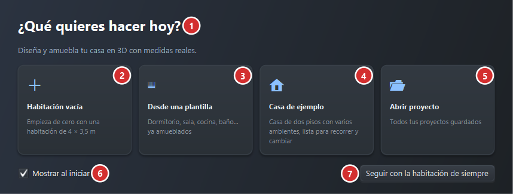

<!-- Tabla: Partes de la pantalla de bienvenida -->
| N.º | Parte | Qué hace | Cuando usarla |
|---|---|---|---|
| 1 | Título **¿Qué quieres hacer hoy?** | Indica que hay que elegir cómo empezar | — |
| 2 | **Habitación vacía** | Empieza de cero con una habitación de 4 × 3,5 m | Cuando ya se conocen las medidas reales del ambiente |
| 3 | **Desde una plantilla** | Abre dormitorio, sala, comedor, cocina, baño u oficina ya amoblados | Para partir de una distribución típica y ajustarla |
| 4 | **Casa de ejemplo** | Carga una casa de dos pisos con 11 ambientes amoblados, lista para recorrer y modificar (sección 12.1) | La primera vez, para practicar sin riesgo |
| 5 | **Abrir proyecto** | Muestra los proyectos guardados, con miniatura | Para continuar un trabajo anterior |
| 6 | **Mostrar al iniciar** | Si se desmarca, esta pantalla ya no aparece al abrir la aplicación | Cuando el usuario ya conoce la aplicación |
| 7 | **Seguir con la habitación de siempre** | Cierra la pantalla y continúa con lo que estaba abierto | Para ir directo a la ventana principal |

Debajo aparecen los **proyectos recientes**. Para no ver esta pantalla al iniciar, se desmarca
**Mostrar al iniciar**; se puede volver a abrir en *Ayuda → Pantalla de bienvenida…*. La primera vez
conviene elegir **Casa de ejemplo**: es la forma más rápida de conocer la aplicación y practicar
sin riesgo.

## 6. La ventana principal

### 6.1 Partes de la ventana

La figura siguiente muestra la sala de la casa de ejemplo con el mueble de TV seleccionado. Los
números señalan las once partes de la ventana, que se describen en la tabla posterior.

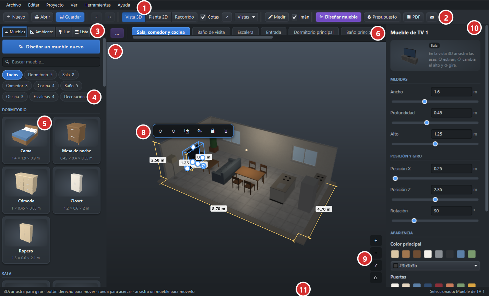

<!-- Tabla: Partes de la ventana principal -->
| N.º | Parte | Ubicación | Para qué sirve |
|---|---|---|---|
| 1 | **Barra de menús** | Arriba | *Archivo*, *Editar*, *Proyecto*, *Ver*, *Herramientas* y *Ayuda*: todas las funciones de la aplicación |
| 2 | **Barra de herramientas** | Debajo del menú | Nuevo, Abrir, Guardar, deshacer, vistas (**Vista 3D**, **Planta 2D**, **Recorrido**), **Cotas**, **Vistas**, **Medir**, **Imán**, **Diseñar mueble**, **Presupuesto**, **PDF** y captura. Al pasar el ratón sobre un botón se muestra qué hace y su atajo |
| 3 | **Pestañas del panel izquierdo** | Izquierda, arriba | **Muebles** (catálogo), **Ambiente** (medidas, acabados, ventanas, puertas y columnas), **Luz** y **Lista** (todo lo que hay en el ambiente) |
| 4 | **Buscador y filtros** | Pestaña Muebles | **Buscar mueble…** y los botones de categoría (Todos, Dormitorio, Sala…); el número indica cuántos muebles hay en cada una |
| 5 | **Tarjetas del catálogo** | Pestaña Muebles | Cada tarjeta muestra el mueble y sus medidas; un clic lo agrega y arrastrarla lo coloca donde se suelta |
| 6 | **Barra de ambientes** | Sobre la vista | **Casa completa**, un botón por ambiente (Sala, Dormitorio…) y **+ Ambiente** |
| 7 | **Vista central** | Centro | El diseño en 3D, en planta o en recorrido, con las cotas en amarillo |
| 8 | **Barra flotante** | Encima del mueble seleccionado | Girar a la izquierda o a la derecha, duplicar, diseñar a partir de este mueble, bloquear y eliminar sin ir al panel |
| 9 | **Controles de la vista** | Esquina inferior derecha de la vista | **+** acerca, **−** aleja y el tercer botón (flechas en diagonal) encuadra el ambiente |
| 10 | **Panel de propiedades** | Derecha | Medidas, posición, giro y colores del elemento seleccionado. Los números se aplican al pulsar `Enter` o al salir del campo |
| 11 | **Barra de estado** | Abajo | A la izquierda, ayuda sobre el ratón o el último aviso; a la derecha, lo que está seleccionado |

El mueble seleccionado se reconoce por el **marco azul** y sus **asas**: los círculos de los lados
estiran el mueble, el rombo de arriba cambia el alto y la flecha circular de adelante lo gira.

### 6.2 Un proyecto nuevo

Con *Archivo → Nuevo proyecto* (`Ctrl+N`) o **Habitación vacía** aparece una habitación de
4 × 3,5 m con una ventana, una puerta, una bombilla y el sol. Mientras no hay nada seleccionado, el
panel derecho muestra la guía **Cómo empezar**.

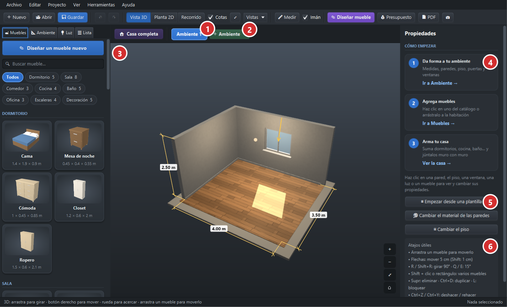

<!-- Tabla: Partes de la pantalla de un proyecto nuevo -->
| N.º | Parte | Qué hacer con ella |
|---|---|---|
| 1 | Botón del ambiente (**Ambiente 1**) | Clic derecho para cambiarle el nombre (por ejemplo, *Dormitorio*), duplicarlo o eliminarlo |
| 2 | **+ Ambiente** | Agrega otro ambiente a la casa: vacío, desde una plantilla o como copia del actual |
| 3 | Habitación en 3D | Clic en una pared, el piso, la ventana o la luz para ver y cambiar sus propiedades |
| 4 | Guía **Cómo empezar** | Tres pasos con su botón: **Ir a Ambiente** (medidas), **Ir a Muebles** (catálogo) y **Ver la casa** |
| 5 | **Empezar desde una plantilla** y botones de materiales | Atajos para cargar una plantilla o cambiar las paredes o el piso |
| 6 | **Atajos útiles** | Recordatorio de las teclas más usadas; `F1` muestra todas |

### 6.3 La pestaña Lista

La pestaña **Lista** muestra todo lo que hay en el ambiente activo: ventanas, puertas, luces y
muebles, cada uno con un punto de color según su tipo. Un clic en un elemento lo selecciona en la
vista y abre sus propiedades a la derecha, lo que sirve para encontrar objetos pequeños o tapados por
otros. Con `Ctrl` o `Shift` se seleccionan varios muebles y con `Supr` se eliminan.

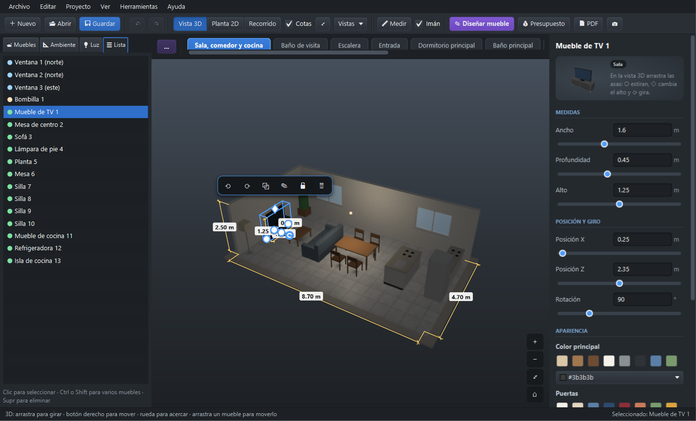

### 6.4 Uso del ratón

<!-- Tabla: Acciones con el ratón en la vista 3D -->
| Acción con el ratón | Resultado |
|---|---|
| Clic | Selecciona un mueble, pared, abertura o luz; clic en el vacío para deseleccionar |
| Arrastrar un mueble | Lo mueve sobre el piso |
| Arrastrar con el botón izquierdo en el vacío | Gira la cámara |
| Arrastrar con el botón derecho | Desplaza la cámara |
| Rueda | Acerca o aleja |

## 7. Configurar el ambiente

Se hace en la pestaña **Ambiente** del panel izquierdo.

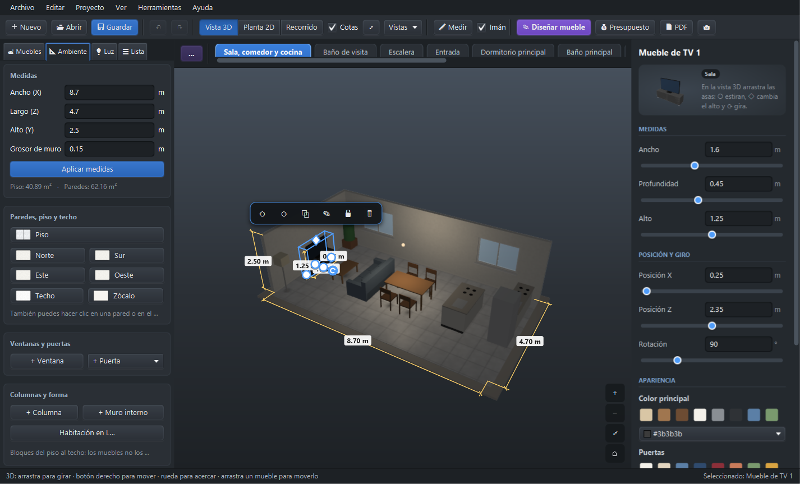

### 7.1 Medidas

<!-- Tabla: Rangos permitidos para las medidas del ambiente -->
| Campo | Rango | Indicación |
|---|---|---|
| Ancho (X) y Largo (Z) | 1 a 30 m | Medidas **interiores**: de pared a pared, por dentro |
| Alto (Y) | 2 a 6 m | Del piso al techo |
| Grosor de muro | 5 a 50 cm | Los muros crecen hacia afuera y no restan espacio |

Se escriben los valores y se pulsa **Aplicar medidas**. Debajo se muestran el área del piso y de las
paredes. Si al achicar el ambiente una ventana o puerta deja de caber, se elimina y la aplicación
indica cuál; se recupera con `Ctrl+Z`.

### 7.2 Ventanas y puertas

- **+ Ventana** agrega una ventana en el primer lugar libre. Las medidas iniciales de cada tipo de
  abertura están en el anexo C.
- **+ Puerta** permite elegir el tipo: *normal*, *principal*, *doble*, *corrediza*, *portón de
  cochera* o *vano sin puerta*. El tipo se puede cambiar después en el panel derecho.
- Al seleccionar la abertura se cambian **pared**, **distancia desde la esquina**, **ancho**,
  **alto** y, en las ventanas, **alféizar**.
- Dos aberturas nunca se superponen: si la posición escrita está ocupada, el cambio no se aplica y
  se explica el motivo.

### 7.3 Columnas y forma

- **+ Columna** (30 × 30 cm) y **+ Muro interno** (1,5 m × 12 cm) agregan bloques del piso al techo.
  Los muebles no los atraviesan y su área se descuenta del piso en el presupuesto. Se mueven con las
  flechas o desde el panel derecho.
- **Habitación en L…** quita una esquina del ambiente: se elige cuál y de qué tamaño.

## 8. Paredes, piso y techo

En la sección **Paredes, piso y techo** de la pestaña Ambiente hay un botón por superficie: **Piso**,
**Norte**, **Sur**, **Este**, **Oeste**, **Techo** y **Zócalo**. También se puede hacer clic sobre
una pared en la vista. En el panel derecho se elige:

- **Material:** pintura mate, pintura satinada, papel tapiz, ladrillo, piedra, concreto, madera,
  cerámico, mármol, porcelanato o alfombra. Solo aparecen los que corresponden a esa superficie (no
  hay alfombra en las paredes).
- **Color:** cualquiera; tiñe la textura.
- **Aplicar a todas:** copia el material y el color a las cuatro paredes.
- **Zócalo:** alto de 0 a 20 cm (0 = sin zócalo; por defecto, 8 cm) y color.

Las texturas están a **escala real**: un ladrillo de la pantalla mide lo que mide un ladrillo.

## 9. Muebles

### 9.1 Agregar

En la pestaña **Muebles** se filtra por categoría con los botones (**Todos**, Dormitorio, Sala,
Comedor, Cocina, Baño, Oficina, Escaleras, Decoración, Mis diseños…; el número indica cuántos hay) o
se escribe en **Buscar mueble…** (no importan las mayúsculas ni las tildes; `Esc` borra la búsqueda).
Luego:

- **Clic** en una tarjeta: el mueble se agrega en un lugar libre.
- **Arrastrar** la tarjeta a la vista: el mueble queda donde se suelta, o en el lugar libre más cercano.

Si el mueble no cabe derecho, la aplicación lo prueba girado; si no cabe de ninguna forma, explica
por qué. Las medidas iniciales y los rangos de cada mueble están en el anexo A.

**Muebles nuevos en la versión 2.1.0.** El catálogo pasó de 18 a 36 muebles paramétricos. Se
agregaron: ropero; mesa de centro, sillón, lámpara de pie y televisor; aparador; isla de cocina y
alacena; tina, ducha y espejo; silla de oficina y estante; y en la categoría nueva **Decoración**:
planta, maceta, alfombra, cuadro y cortina. Todos se agregan, mueven y editan igual que los demás.
La figura muestra dónde encontrarlos; cada flecha señala el nombre de un elemento y la tabla explica
su función.

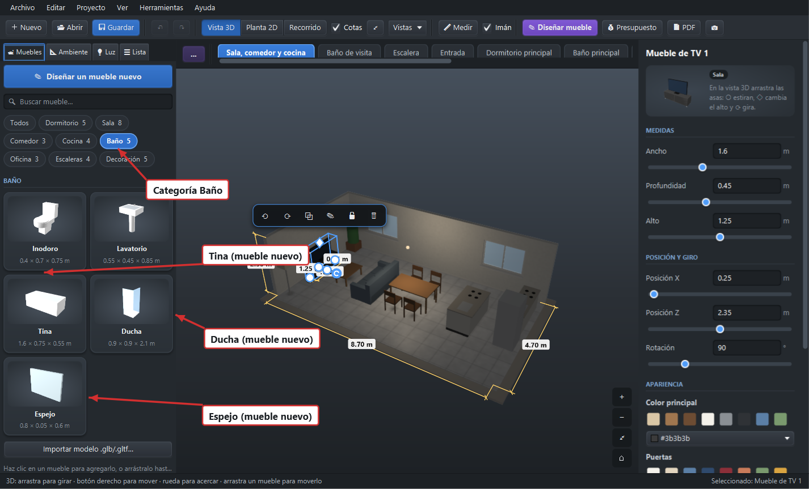

<!-- Tabla: Elementos señalados en el catálogo de muebles -->
| Elemento señalado | Función | Para qué sirve |
|---|---|---|
| **Categoría Baño** | Botón de categoría; el número (5) indica cuántos muebles tiene | Muestra solo los muebles de baño: inodoro, lavatorio, tina, ducha y espejo |
| **Tina (mueble nuevo)** | Tarjeta del mueble: imagen, nombre y medidas iniciales (1,6 × 0,75 × 0,55 m) | Con un clic se agrega la tina en un lugar libre del ambiente; también se puede arrastrar a la vista |
| **Ducha (mueble nuevo)** | Tarjeta de la ducha con mampara (0,9 × 0,9 × 2,1 m) | Prueba si la ducha entra en el baño sin tapar la puerta |
| **Espejo (mueble nuevo)** | Tarjeta del espejo de pared (0,8 × 0,05 × 0,6 m) | Completa el baño; su medida se cambia en el panel de propiedades |

Para volver a ver todo el catálogo, pulse **Todos**.

### 9.2 Mover, girar y cambiar medidas

<!-- Tabla: Formas de mover, girar y redimensionar un mueble -->
| Acción | Cómo |
|---|---|
| Mover | Arrastrar con el ratón · flechas (5 cm) · `Shift` + flechas (1 cm) · campos **Posición X/Z** |
| Girar | `R` / `Shift+R` (90°) · `Q` / `E` (15°) · asa redonda delante del mueble · campo **Rotación** |
| Cambiar medidas | Asas en los lados y arriba del mueble seleccionado, o campos **Ancho**, **Profundidad** y **Alto** |
| Agrandar o achicar todo | Botones ±10 % del panel; **Medidas originales** para volver |
| Duplicar / eliminar | `Ctrl+D` / `Supr` |
| Bloquear | `L` o el candado de la barra flotante: un mueble bloqueado no se mueve ni se borra por accidente |

**Imán (`G`):** al arrastrar, el mueble se pega a las paredes y a los bordes o centros de otros
muebles que estén a menos de 8 cm, y aparecen líneas guía. Mientras se mantiene `Alt`, el imán no actúa.

### 9.3 Varios muebles a la vez

- `Shift` o `Ctrl` + clic: agrega o quita un mueble de la selección.
- `Shift` + arrastrar en el vacío: rectángulo de selección.
- `Ctrl+A`: selecciona todos los muebles.

Los muebles seleccionados se mueven, giran, duplican o eliminan juntos. Si alguno chocaría con algo,
no se mueve ninguno.

En la figura siguiente se seleccionaron los cinco muebles de la sala con `Ctrl+A`: cada uno muestra
su marco azul y el panel derecho cambia a **5 muebles seleccionados**, con los botones para girarlos
90° a la izquierda o a la derecha, **Duplicar**, **Eliminar** y la casilla **Bloqueados**. La barra
de estado confirma cuántos hay seleccionados.

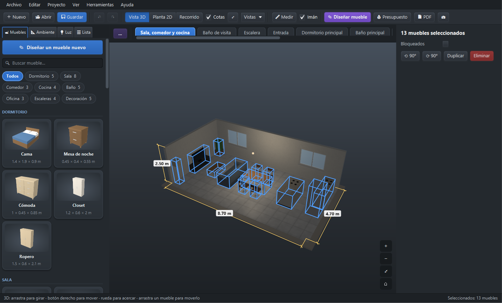

### 9.4 Copiar y pegar

`Ctrl+C`, `Ctrl+X` y `Ctrl+V` funcionan también entre proyectos distintos. Si el lugar original está
ocupado, el mueble se pega en el lugar libre más cercano.

### 9.5 Colores y acabado

En **Apariencia**, en el panel derecho, se elige el **color principal**, el **color secundario**
(frazada, cojines, frentes de cajones, puertas, patas, encimera, grifería…) y el **acabado** (mate,
satinado, brillante o metálico). Los modelos 3D importados también se pueden **teñir**.

### 9.6 Importar un modelo 3D

En *Archivo → Importar modelo 3D (.glb/.gltf)…* (`Ctrl+I`) se elige el archivo y se revisan el
nombre, el giro (para que el frente mire hacia adelante) y las **medidas reales**; con **Mantener
proporciones** basta cambiar una de ellas. Se consiguen modelos gratuitos en Poly Haven, Sketchfab
(filtro *Downloadable*) y Kenney (*Furniture Kit*); antes de usarlos debe revisarse la licencia de
cada uno. No se admiten modelos comprimidos con Draco o Meshopt.

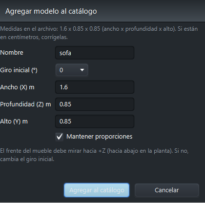

En la ventana **Agregar modelo al catálogo**, la primera línea muestra las medidas leídas del
archivo; si el modelo fue creado en centímetros aparecerán valores muy grandes y hay que corregirlos.
**Giro inicial** se usa cuando el frente del mueble no mira hacia abajo en la planta. Con **Mantener
proporciones** marcado, al cambiar el ancho cambian también la profundidad y el alto. **Agregar al
catálogo** lo deja disponible en la pestaña Muebles con la etiqueta *3D*.

## 10. Diseñador de muebles

Se abre con el botón **Diseñar mueble** o con `Ctrl+Shift+D`.

En la figura siguiente se eligió *Empezar desde… → Copia de: Escritorio*: el diseñador cargó las
siete piezas del escritorio del catálogo, que ahora se pueden cambiar una por una.

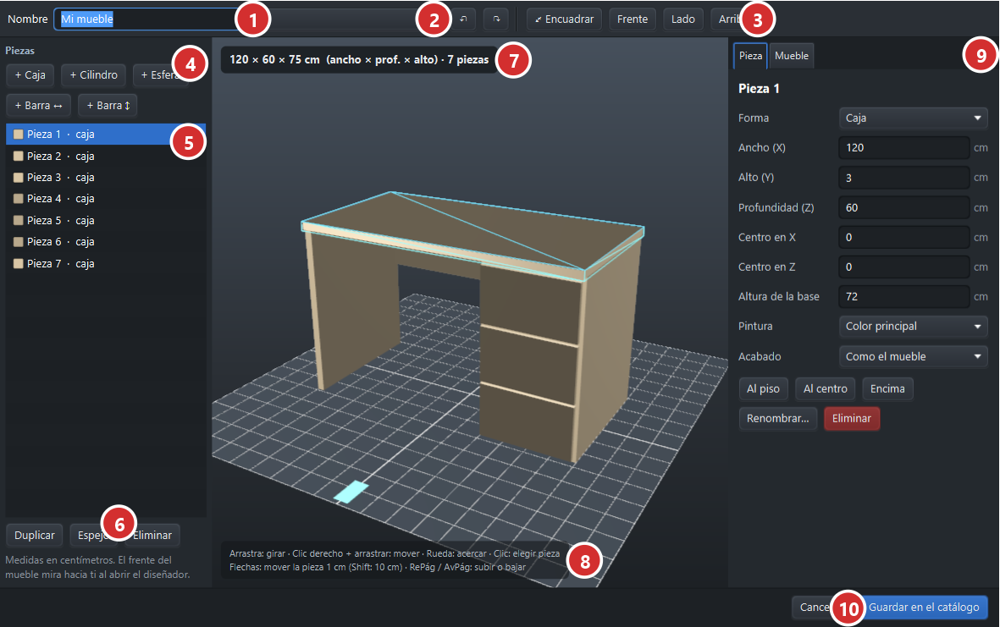

<!-- Tabla: Partes del diseñador de muebles -->
| N.º | Parte | Uso |
|---|---|---|
| 1 | **Nombre** | Nombre con el que el mueble aparecerá en el catálogo (hasta 40 caracteres) |
| 2 | **Empezar desde…** | Punto de partida: plantilla (caja, mesa, mesa redonda, estante, banco) o copia de un mueble del catálogo. Reemplaza las piezas actuales |
| 3 | **Encuadrar**, **Frente**, **Lado** y **Arriba** | Cambian el punto de vista de la vista 3D; las flechas ↶ ↷ de la izquierda deshacen y rehacen |
| 4 | **+ Caja**, **+ Cilindro**, **+ Esfera**, **+ Barra** | Agregan una pieza nueva al mueble |
| 5 | Lista de **Piezas** | Todas las piezas del mueble; un clic selecciona la que se va a editar (resaltada en azul y con contorno celeste en 3D) |
| 6 | **Duplicar**, **Espejo**, **Eliminar** | Copian la pieza, la copian reflejada al otro lado (útil para patas y laterales) o la borran |
| 7 | Medidas del mueble | Ancho × profundidad × alto del mueble completo, en centímetros, y número de piezas |
| 8 | Ayuda del ratón | Recuerda cómo girar, mover y elegir piezas en la vista 3D |
| 9 | Pestañas **Pieza** y **Mueble** | **Pieza:** forma, medidas y posición **en centímetros**, pintura y acabado, y los botones **Al piso**, **Al centro** y **Encima**. **Mueble:** categoría y colores del mueble completo |
| 10 | **Guardar en el catálogo** | Agrega el mueble al catálogo (por defecto, en *Mis diseños*); **Cancelar** cierra sin guardar |

Dentro del diseñador: `Ctrl+Z` y `Ctrl+Y` deshacen y rehacen, `Ctrl+D` duplica la pieza, `Supr` la
elimina y las flechas la mueven. El mueble completo no puede medir más de 6 × 6 × 4 m.

Para modificar un mueble ya colocado, se selecciona y se usa **Diseñar a partir de este…**; al
guardar, el mueble se reemplaza en el mismo lugar. Con clic derecho sobre un diseño del catálogo se
puede editar, duplicar o quitar.

## 11. Luces

Se configuran en la pestaña **Luz**.

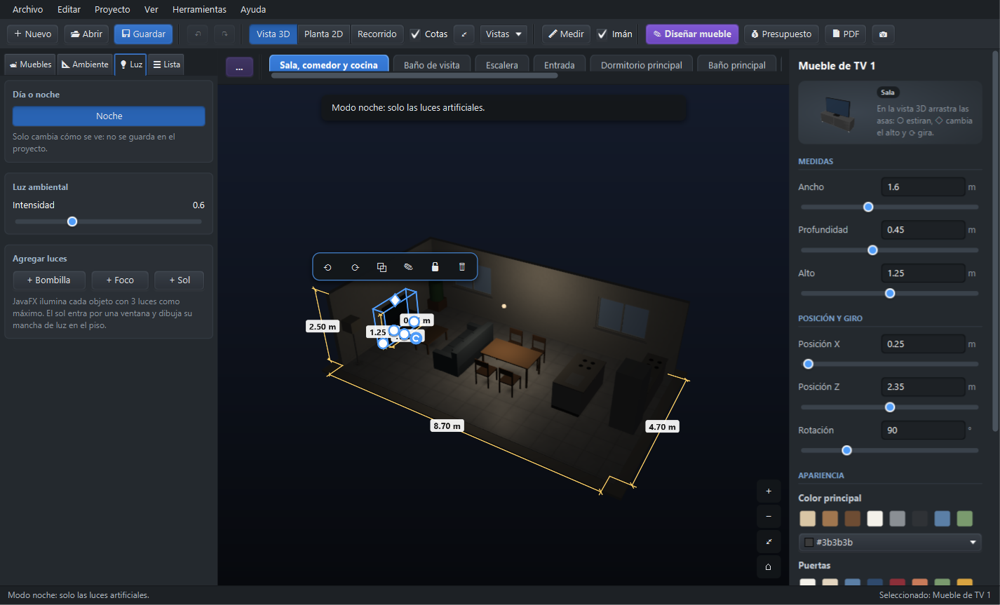

<!-- Tabla: Tipos de luz disponibles -->
| Botón | Tipo de luz |
|---|---|
| **+ Bombilla** | Luz puntual que ilumina en todas direcciones |
| **+ Foco** | Cono de luz dirigido a un punto del piso |
| **+ Sol** | Luz solar que entra por una ventana y dibuja su mancha en el piso |

- **Luz ambiental:** regula la claridad general.
- **Día o noche** (`N`): el modo noche quita el sol y baja la luz ambiental para apreciar las
  lámparas. Solo cambia la vista; no se guarda en el proyecto.
- Cada objeto se ilumina con **un máximo de 3 luces** a la vez (límite de JavaFX).
- El sol necesita una ventana: si se elimina la última ventana, el sol también se elimina.

## 12. Casa con varios ambientes

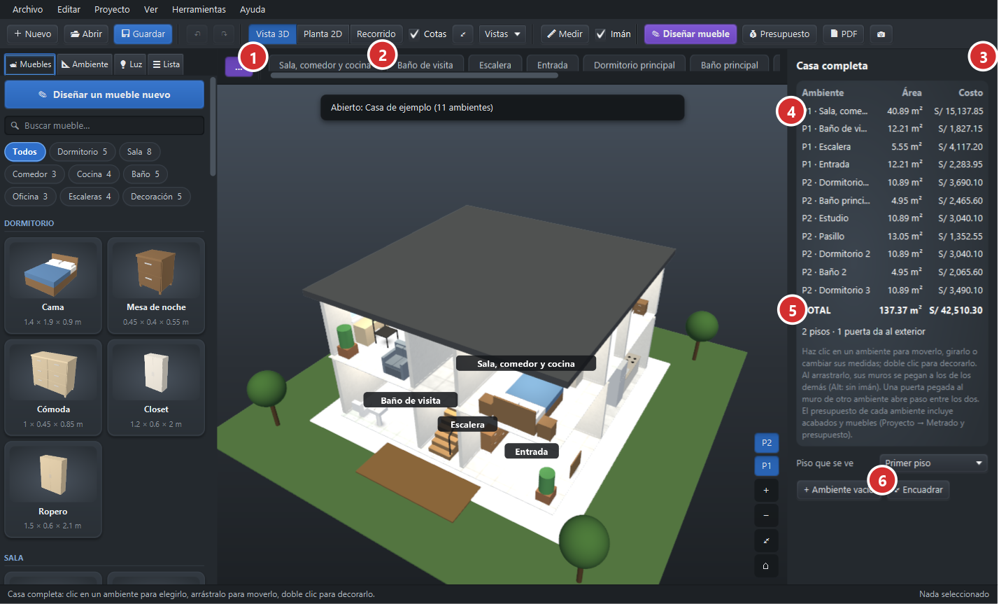

<!-- Tabla: Partes de la vista Casa completa -->
| N.º | Parte | Uso |
|---|---|---|
| 1 | **Casa completa** | Activa o desactiva la vista de todos los ambientes juntos (`Ctrl+4`) |
| 2 | Botones de los ambientes | Un clic entra a decorar ese ambiente; clic derecho para renombrar, duplicar o eliminar |
| 3 | **+ Ambiente** | Agrega un ambiente vacío, desde una plantilla o como copia del actual |
| 4 | Tabla de ambientes | Área del piso y costo estimado (acabados y muebles) de cada ambiente |
| 5 | **TOTAL** | Área y costo de toda la casa, número de pisos y puertas que dan al exterior |
| 6 | **+ Ambiente vacío** y **Encuadrar** | Agregan un ambiente de 3,5 × 3 m o centran la cámara en la casa; encima, **Piso que se ve** elige el piso que se muestra |

- **+ Ambiente**, en la barra de ambientes, agrega un ambiente vacío, desde una plantilla o como
  copia del actual. Se coloca pegado a los demás.
- **Clic** en un ambiente de la barra para decorarlo; **clic derecho** para renombrarlo, duplicarlo
  o eliminarlo. Una casa admite hasta 30 ambientes.
- **Casa completa** (`Ctrl+4`) muestra todos los ambientes juntos, en 3D o en planta:
  - Se **arrastra** un ambiente para ubicarlo; los muros se pegan a los de los demás y nunca se
    enciman (con `Alt` se mueve sin imán).
  - En el panel derecho se cambian las medidas, el **giro** (de 90 en 90°) y el **piso** (hasta 4).
  - **Piso que se ve** elige qué piso mostrar; en 3D se ven ese piso y los de abajo.
  - **Doble clic** en un ambiente para entrar a decorarlo.
- Si la puerta de un ambiente toca el muro de otro, ese muro se abre para dar paso.
- El resumen de la derecha muestra el **área** y el **costo** de cada ambiente y de toda la casa, y
  avisa si ninguna puerta da a la calle.

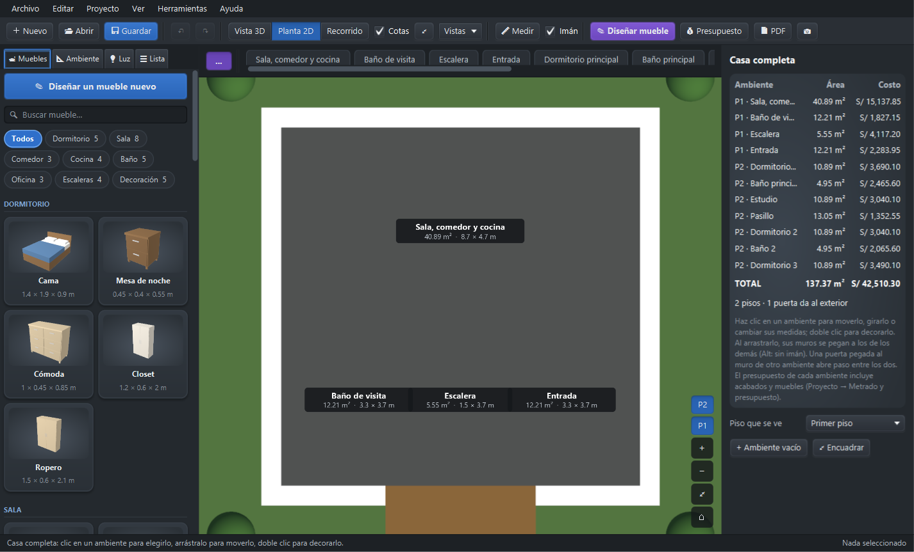

### 12.1 La casa de ejemplo

**Casa de ejemplo**, en la pantalla de bienvenida, abre una casa de dos pisos de 9,00 × 9,00 m por
fuera, dibujada a escala y con muros de 15 cm. Es un proyecto normal: se puede recorrer, cambiar y
guardar con otro nombre sin afectar el ejemplo original. Medidas interiores (sin muros):

<!-- Tabla: Ambientes de la casa de ejemplo con sus medidas interiores -->
| Piso | Ambiente | Medidas interiores (m) | Puertas |
|---|---|---|---|
| 1 | Sala, comedor y cocina | 8,70 × 4,70 | Comunica con el baño de visita, la escalera y la entrada |
| 1 | Baño de visita | 3,30 × 3,70 | Puerta hacia la sala |
| 1 | Escalera | 1,50 × 3,70 | Vano hacia la sala; la escalera sube al pasillo del piso 2 |
| 1 | Entrada | 3,30 × 3,70 | Puerta principal hacia la calle y vano hacia la sala |
| 2 | Dormitorio principal, Estudio, Dormitorio 2 y Dormitorio 3 | 3,30 × 3,30 cada uno | Cada uno con puerta hacia el pasillo |
| 2 | Baño principal y Baño 2 | 3,30 × 1,50 cada uno | Cada uno con puerta hacia el pasillo |
| 2 | Pasillo | 1,50 × 8,70 | Recorre el piso de norte a sur |

Los dos lados del pasillo son iguales: a cada lado hay un dormitorio, un baño y otro ambiente de las
mismas medidas. Los ambientes vecinos comparten la línea de sus muros, así que ninguno se encima y
cada puerta abre paso al ambiente de al lado.

### 12.2 Fachada, exteriores, pisos y techo (nuevo en la versión 2.1.0)

En **Casa completa** con la **Vista 3D** (`Ctrl+4` y luego `Ctrl+1`), la casa se ve como una maqueta:
todos los pisos apilados, el techo encima, la fachada con acabado liso en los muros que dan afuera, y
alrededor un patio pavimentado, césped, un deck de madera frente a la entrada y árboles. La luz
imita al sol: cálida desde arriba y más fría en las sombras.

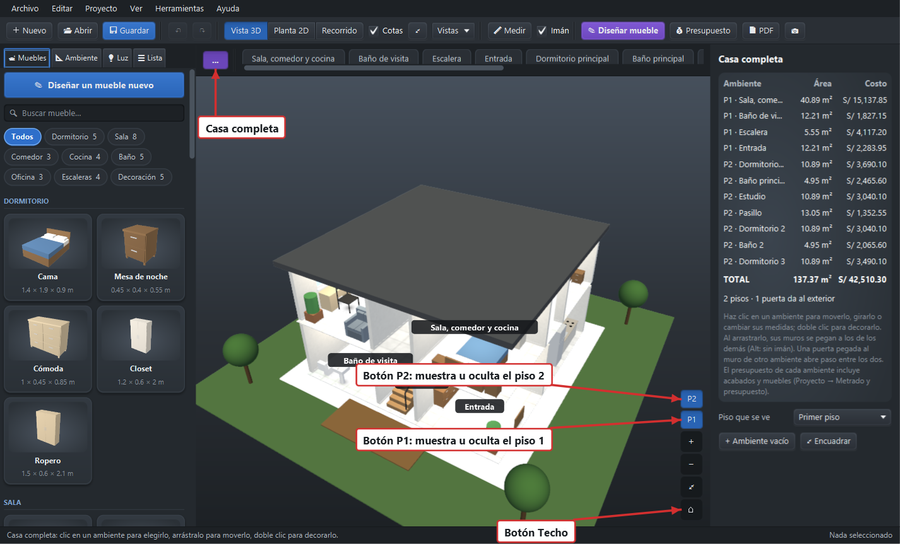

<!-- Tabla: Elementos señalados en la vista de la casa completa -->
| Elemento señalado | Función | Para qué sirve |
|---|---|---|
| **Casa completa** | Botón morado a la izquierda de la barra de ambientes (también `Ctrl+4`) | Pasa de decorar un ambiente a ver la casa entera, y al revés |
| **Botón P2** | Interruptor del piso 2; en azul el piso se ve, en gris está oculto | Ocultar el piso de arriba para mirar el de abajo sin quitar nada del proyecto |
| **Botón P1** | Interruptor del piso 1, con el mismo funcionamiento | Ver solo el piso de arriba, por ejemplo para revisar los dormitorios |
| **Botón Techo** | Último botón de la columna de la derecha, con el dibujo de una casita, debajo del zoom y de Encuadrar | Muestra la casa cerrada con su techo, como se ve desde la calle, o lo quita para ver el interior |

Los botones **P1**, **P2**… aparecen solo en **Casa completa** y cuando la casa tiene más de un piso
(uno por piso, hasta 4). Al pulsar **Techo**, abajo aparece el aviso *«Techo visible: fachada de la
casa»* o *«Techo oculto: interior visible»*. Estos botones solo cambian lo que se ve: no borran ni
mueven nada, y el presupuesto no cambia.

Para mirar dentro del primer piso:

1. Pulse el botón **Techo** para quitar el techo.
2. Pulse **P2** para ocultar el segundo piso: queda en gris.
3. Gire la cámara con el botón izquierdo del ratón y acerque con la rueda.
4. Para volver a la maqueta completa, pulse otra vez **P2** y **Techo**.

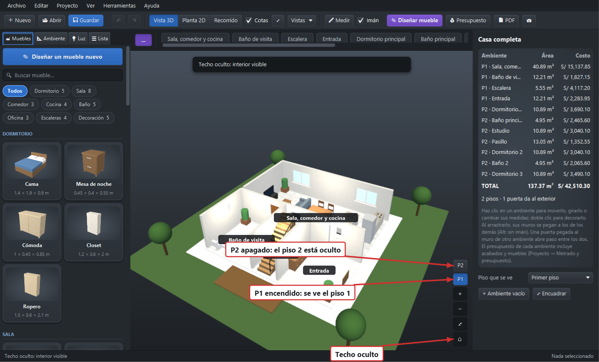

<!-- Tabla: Elementos señalados con el techo y el piso 2 ocultos -->
| Elemento señalado | Función | Para qué sirve |
|---|---|---|
| **P2 apagado: el piso 2 está oculto** | El botón en gris indica que ese piso no se dibuja | Dejar a la vista los ambientes del piso 1 con sus muebles |
| **P1 encendido: se ve el piso 1** | El botón en azul indica que ese piso se dibuja | Confirmar qué piso se está mirando |
| **Techo oculto** | El techo está quitado; el aviso de arriba lo confirma | Mirar el interior desde arriba, como en una maqueta abierta |

**Piso que se ve**, en el panel derecho, sigue disponible: elige un piso y muestra ese y los de abajo.
Los botones P1, P2… permiten además ocultar un piso cualquiera, incluso uno de abajo.

## 13. Ver y recorrer

<!-- Tabla: Modos de vista y sus atajos -->
| Vista | Atajo | Uso |
|---|---|---|
| **Vista 3D** | `Ctrl+1` | Girar alrededor del ambiente |
| **Planta 2D** | `Ctrl+2` | Vista desde arriba con cotas, como un plano |
| **Recorrido** | `Ctrl+3` | Caminar a la altura de los ojos |

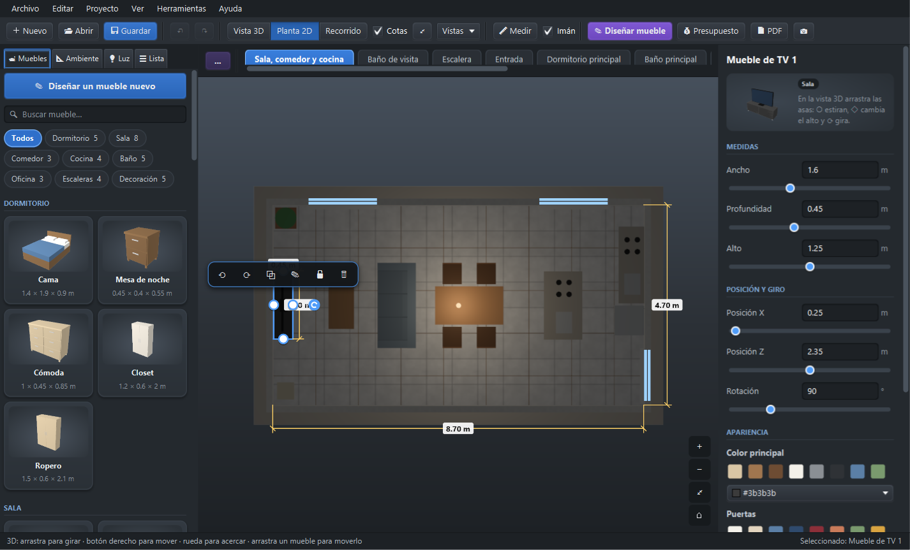

**Recorrido:** `W`/`S` o ↑/↓ para avanzar y retroceder, `A`/`D` para moverse de costado, ←/→ para
girar, arrastrar con el ratón para mirar y `Shift` para correr. No se atraviesan paredes ni muebles.
El techo solo se dibuja en el recorrido, para que en las demás vistas se vea el interior desde arriba.

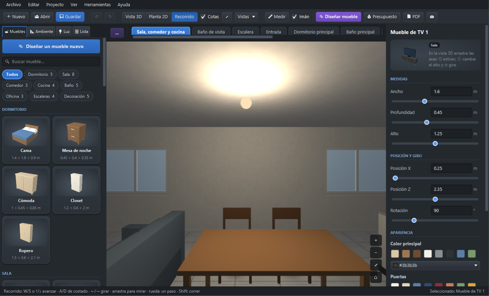

**Otras herramientas:**

- **Vistas:** guarda la vista actual con un nombre (queda en el proyecto), vuelve a ella o muestra
  el ambiente desde cada puerta.
- **Cotas** (`Ctrl+M`): muestra u oculta las medidas.
- **Medir** (`M`): dos clics en el piso; los puntos se pegan a paredes y esquinas. `Esc` termina.
- *Ver → Centrar cámara* (`Ctrl+0`) encuadra el ambiente; *Archivo → Exportar imagen PNG…*
  (`Ctrl+E`) guarda una captura de la vista; `F11` activa la pantalla completa.

## 14. Presupuesto e informe PDF

**Presupuesto** (`Ctrl+P`) abre la ventana *Metrado y presupuesto*:

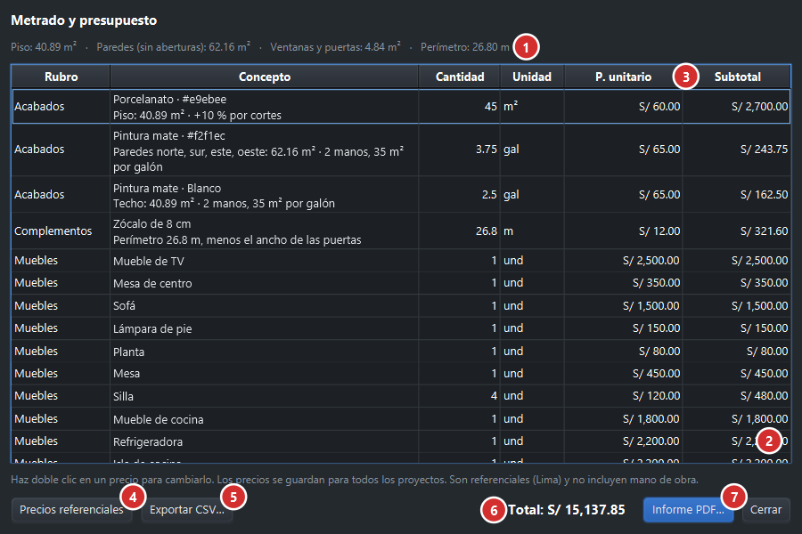

<!-- Tabla: Partes de la ventana Metrado y presupuesto -->
| N.º | Parte | Qué muestra o qué hace |
|---|---|---|
| 1 | **Resumen** | m² de piso, de paredes **sin** ventanas ni puertas, de ventanas y puertas, y perímetro |
| 2 | Tabla del metrado | Una fila por partida: **rubro**, **concepto** (material, color y cómo se calculó), **cantidad**, **unidad**, **precio unitario** y **subtotal** |
| 3 | Columna **P. unitario** | Doble clic sobre un precio para cambiarlo; el nuevo precio se guarda para todos los proyectos |
| 4 | **Precios referenciales** | Restablece los precios originales de la aplicación |
| 5 | **Exportar CSV…** | Guarda el presupuesto en un archivo que se abre en Excel |
| 6 | **Total** | Suma de todos los subtotales, en soles |
| 7 | **Informe PDF…** | Genera el informe PDF del ambiente (sección siguiente); **Cerrar** vuelve a la ventana principal |

Las filas de la tabla se agrupan en tres rubros:

- **Acabados:** pintura en galones para 2 manos (un galón cubre unos 35 m² por mano), redondeada al
  cuarto de galón; papel tapiz en rollos; pisos y enchapes en m² con **10 % de desperdicio**.
- **Complementos:** zócalo en metros, sin contar el ancho de las puertas.
- **Muebles** con su precio.

Los precios son **referenciales, en soles (Lima, 2026)**, y no incluyen mano de obra; la lista
completa está en el anexo B. Se cambian con
**doble clic** sobre el precio y se conservan para todos los proyectos. **Precios referenciales**
restablece los originales y **Exportar CSV…** guarda el presupuesto para abrirlo en Excel.

**PDF** (`Ctrl+Shift+P`), o **Informe PDF…** dentro del presupuesto, genera un informe con los datos
del ambiente, la planta con cotas, la vista 3D, las ventanas y puertas, los muebles y el presupuesto,
listo para imprimir o enviar. La figura siguiente muestra las tres páginas del informe de la sala de
ejemplo: la página 1 resume la habitación (medidas, áreas, volumen y acabado de cada superficie); la
página 2, la planta con cotas y la vista 3D; y la página 3, las ventanas y puertas, los muebles con su
posición y el metrado y presupuesto con los subtotales por rubro.

## 15. Guardar y compartir proyectos

<!-- Tabla: Formas de guardar y compartir proyectos -->
| Acción | Dónde | Detalle |
|---|---|---|
| Guardar / Guardar como | `Ctrl+S` / `Ctrl+Shift+S` | En la base de datos local, con miniatura. Los nombres no se repiten |
| Abrir | `Ctrl+O` | Lista con miniaturas; desde ahí también se renombra o elimina |
| Nuevo desde plantilla | `Ctrl+Shift+N` | Plantillas con vista previa (Figura siguiente) |
| Exportar | *Archivo → Exportar archivo .amob3d…* | Para llevar el proyecto a otra computadora; incluye los diseños propios que use |
| Importar | *Archivo → Importar archivo .amob3d…* | Si una parte del archivo está dañada, se corrige o descarta y se avisa |
| Deshacer / rehacer | `Ctrl+Z` / `Ctrl+Y` | Hasta 100 pasos, incluidos los cambios de la casa |

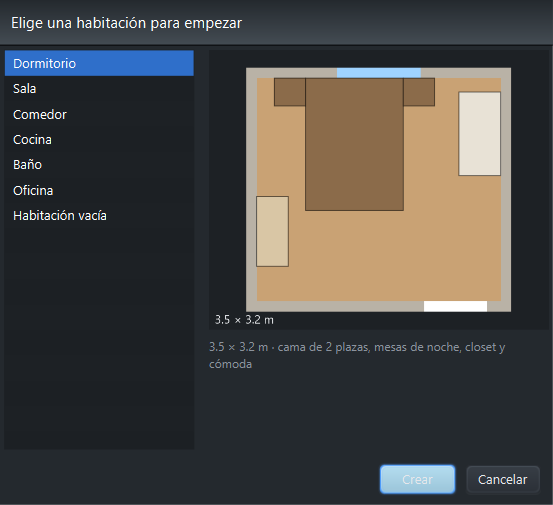

La ventana **Proyectos guardados** (`Ctrl+O`) lista los proyectos con su miniatura y la fecha de la
última modificación. Se elige uno y se pulsa **Abrir**; los botones **Renombrar…** y **Eliminar**
actúan sobre el proyecto seleccionado (eliminar pide confirmación).

**Autoguardado:** mientras hay cambios sin guardar, la aplicación hace una copia cada minuto. Si se
cierra de golpe (corte de luz o error), al volver a abrirla ofrece **recuperar** el trabajo. La copia
se borra al guardar o al cerrar normalmente.

## 16. Tutoriales paso a paso

### 16.1 Amoblar un dormitorio de 3,5 × 3 m

1. *Archivo → Nuevo proyecto* (`Ctrl+N`).
2. En la pestaña **Ambiente**, escriba Ancho `3.5`, Largo `3` y Alto `2.5`, y pulse **Aplicar medidas**.
3. Pulse **+ Puerta → normal**. En el panel derecho elija la pared **Sur** y una distancia de
   `0.3` m desde la esquina.
4. Pulse **+ Ventana**. Elija la pared **Norte** y un ancho de `1.2` m.
5. En la pestaña **Muebles**, categoría **Dormitorio**, haga clic en **Cama**, en **Mesa de noche**
   (dos veces) y en **Closet**.
6. Arrastre la cama contra la pared norte (el imán la pega) y las mesas de noche a sus lados.
7. Seleccione el closet, gírelo con `R` hasta que su frente mire al centro y llévelo a una pared libre.
8. En *Paredes, piso y techo*, pulse **Norte** y elija el material **Papel tapiz** y un color.
9. Pulse `Ctrl+3` y recorra el dormitorio para comprobar que la puerta abre y que se puede caminar.
10. Pulse `Ctrl+S` y guarde el proyecto con el nombre *Mi dormitorio*.

**Resultado:** un dormitorio sin muebles encimados ni puertas bloqueadas, guardado con su miniatura.

### 16.2 Armar una casa de dos pisos

La casa de ejemplo ya tiene dos pisos (sección 12.1). Para armar una propia desde cero:

1. En la pantalla de bienvenida, elija **Habitación vacía** y, en el panel derecho, escriba las
   medidas de la sala.
2. Pulse **+ Ambiente → desde una plantilla → Dormitorio**.
3. Pulse `Ctrl+4` (**Casa completa**), seleccione el ambiente nuevo y, en el panel derecho, cambie
   **Piso** a *Segundo piso*.
4. Arrastre el dormitorio hasta que quede encima de la sala; en otro piso no choca con los de abajo.
5. Entre a la sala y agregue una **Escalera en L** desde la categoría **Escaleras**: su altura se
   ajusta sola hasta el techo.
6. Pulse `Ctrl+1` (**Vista 3D**): con los botones **P1** y **P2** oculte o muestre cada piso, y con
   **Techo** cierre la casa para verla como desde la calle (sección 12.2).

### 16.3 Calcular el presupuesto de pintar la sala

1. Abra la sala y seleccione cada pared: material **Pintura mate**, color *Blanco hueso* (o use
   **Aplicar a todas** desde la primera pared).
2. Pulse `Ctrl+P`. La línea *Pintura mate* muestra los m² (sin ventanas ni puertas) y los galones
   para 2 manos.
3. Haga doble clic en el **P. unitario** de la pintura y escriba el precio de la ferretería: el
   total se recalcula.
4. Pulse **Exportar CSV…** para llevarlo a Excel o **Informe PDF…** para imprimirlo.

## 17. Mensajes del sistema

Los avisos aparecen unos segundos sobre la vista, o en una ventana cuando necesitan una respuesta.
Los avisos de error se muestran en **rojo** y los informativos en gris oscuro; el mismo texto queda
en la barra de estado para leerlo con calma.

En la figura siguiente se agregaron closets a una habitación de 4 × 3,5 m hasta llenarla. El último
no cabía en ningún lugar libre, ni siquiera girado, y la aplicación lo rechazó con el aviso *No hay
espacio libre para closet (1.2 x 0.6 m)*, que se repite abajo, en la barra de estado. El mueble no se
agregó: el diseño queda como estaba y el aviso explica el motivo.

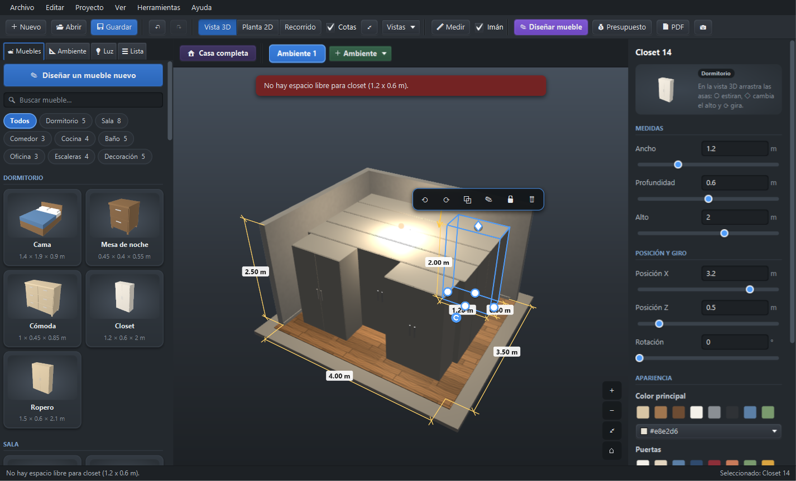

<!-- Tabla: Mensajes del sistema y acciones recomendadas -->
| Mensaje | Qué significa | Qué hacer |
|---|---|---|
| *No hay espacio libre para …* | El mueble no entra en ningún lugar libre del ambiente | Achicar o mover otros muebles, o agrandar el ambiente |
| *Choca con …* / *Bloquea el paso de …* | En el destino hay otro mueble, una columna o el paso de una puerta | Moverlo a otro lugar o soltar el imán con `Alt` |
| *No cabe dentro de la habitación en esa posición* | El mueble saldría de las paredes | Acercarlo al centro o achicarlo |
| *Es más alto (…) que la habitación (…)* | El alto del mueble supera el del ambiente | Reducir el alto del mueble o subir el alto del ambiente |
| *Taparía …* / *Quedaría encima de …* | Una columna o muro interno cubriría una ventana, una puerta o una luz | Ubicar la columna en otro lugar |
| *… ya no cabía y se eliminó* | Al achicar el ambiente, una ventana o puerta quedó fuera | `Ctrl+Z` si fue un error |
| *… está bloqueado: desbloquéalo para cambiarlo* | El mueble tiene el candado puesto | Pulsar `L` para desbloquearlo |
| *Ya existe un proyecto llamado …* | Los nombres no se repiten (sin importar mayúsculas) | Usar otro nombre |
| *¿Guardar los cambios de …?* | Se va a cerrar o abrir otro proyecto con cambios sin guardar | **Guardar**, **No guardar** o **Cancelar** |
| *¿Quieres recuperarlos?* (al abrir) | La última vez la aplicación se cerró de golpe | **Recuperar** para volver a lo que se tenía |
| *El archivo no es un modelo glTF válido* | El archivo está dañado o no es un modelo 3D | Descargarlo de nuevo o probar otro |
| *No se admiten modelos comprimidos con Draco/Meshopt* | El modelo usa una compresión que la aplicación no lee | Descargar la versión sin comprimir |
| *La base de datos fue creada con una versión más nueva de Space Cat* | Los datos se abrieron con una versión anterior de la aplicación | Instalar la versión más reciente |
| *Agrega una puerta principal en una pared que dé a la calle* | En la casa completa, ninguna puerta da al exterior | Agregar una puerta en una pared exterior |
| *No se pudo exportar: …* | El archivo de destino está abierto en otro programa o la carpeta no tiene permiso | Cerrar el archivo o elegir otra carpeta |
| *Algo salió mal* | Ocurrió un error inesperado, que quedó en el registro | Guardar el trabajo y enviar el registro al soporte (sección 19) |

## 18. Atajos de teclado

`F1` (o *Ayuda → Atajos de teclado*) muestra todos los atajos dentro de la aplicación, en la ventana
de la figura siguiente; **Aceptar** la cierra.

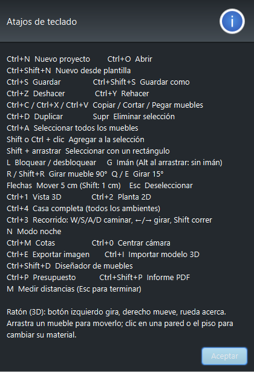

<!-- Tabla: Atajos de teclado -->
| Tecla | Acción |
|---|---|
| `Ctrl+N` / `Ctrl+O` / `Ctrl+S` | Nuevo / Abrir / Guardar |
| `Ctrl+Shift+S` | Guardar como |
| `Ctrl+Shift+N` | Nuevo desde plantilla |
| `Ctrl+Z` / `Ctrl+Y` | Deshacer / Rehacer |
| Flechas (`Shift`: más fino) | Mover el mueble 5 cm (1 cm) |
| `R` / `Shift+R` · `Q` / `E` | Girar 90° · girar 15° |
| `Supr` / `Ctrl+D` | Eliminar / Duplicar |
| `Ctrl+C` / `Ctrl+X` / `Ctrl+V` | Copiar / Cortar / Pegar |
| `Ctrl+A` | Seleccionar todos los muebles |
| `L` / `G` | Bloquear / Imán |
| `Esc` | Deseleccionar o terminar la medición |
| `Ctrl+1` / `Ctrl+2` / `Ctrl+3` / `Ctrl+4` | Vista 3D / Planta / Recorrido / Casa completa |
| `N` | Modo noche |
| `Ctrl+P` / `Ctrl+Shift+P` | Presupuesto / Informe PDF |
| `Ctrl+Shift+D` | Diseñador de muebles |
| `Ctrl+I` | Importar modelo 3D |
| `Ctrl+M` / `Ctrl+0` / `Ctrl+E` | Cotas / Centrar cámara / Exportar imagen PNG |
| `M` | Medir distancias |
| `F11` | Pantalla completa |
| `F1` | Lista de atajos |

## 19. Solución de problemas

<!-- Tabla: Problemas frecuentes y su solución -->
| Problema | Solución |
|---|---|
| Un mueble no se mueve | Puede estar **bloqueado** (pulsar `L`) o chocaría con algo en ese lugar |
| El mueble no queda donde se suelta | Mantener `Alt` mientras se arrastra, o desactivar el imán con `G` |
| No se ve el techo | Solo se dibuja en el **Recorrido** (`Ctrl+3`) |
| La vista 3D se ve negra o lenta | Actualizar el controlador de la tarjeta de video |
| *No se pudo abrir la base de datos* | Hay otra ventana de Space Cat abierta, o el archivo `.db` está abierto en otro programa: cerrarlos y volver a abrir |
| Un modelo importado se ve gigante o diminuto | Corregir sus medidas reales al importarlo o en el panel derecho |
| Se perdió el trabajo por un corte de luz | Abrir la aplicación: ofrece recuperar la última copia automática (se hace cada minuto) |
| Apareció *Algo salió mal* | Guardar el trabajo, abrir *Ayuda → Abrir registro de errores* y enviar el archivo `amoblador3d-0.log` al soporte de Space Cat por WhatsApp (919 192 008) |
| ¿Dónde están los datos? | En `%APPDATA%\Space Cat` (se escribe esa ruta en la barra de direcciones del Explorador de Windows) |
| ¿Cómo se hace una copia de seguridad? | Con la aplicación cerrada, copiar la carpeta `%APPDATA%\Space Cat`, o exportar cada proyecto como `.amob3d` |

## 20. Consejos de buen uso

- **Mida antes de dibujar.** Tome las medidas reales de la habitación (ancho, largo y alto) y la
  posición de puertas y ventanas: el presupuesto y la distribución dependen de ellas.
- **Empiece desde una plantilla** (`Ctrl+Shift+N`) si el ambiente se parece a uno de los incluidos;
  luego cambie medidas y muebles.
- **Coloque primero puertas y ventanas**, después los muebles grandes (cama, closet, sofá) y al final
  los pequeños. Así la aplicación le avisa a tiempo si algo tapa el paso.
- **Bloquee lo que ya está bien ubicado** (`L`), para no moverlo sin querer.
- **Revise en el recorrido** (`Ctrl+3`) si se puede pasar entre los muebles: lo que en planta parece
  cómodo puede quedar estrecho a la altura de los ojos.
- **Guarde seguido** (`Ctrl+S`) y exporte una copia `.amob3d` de los proyectos importantes. El
  autoguardado protege de un cierre inesperado, pero no reemplaza a guardar.
- **Actualice los precios** de la tabla de presupuesto con los de su ferretería antes de comprar: los
  incluidos son referenciales.
- **Use nombres claros** para proyectos, ambientes y vistas guardadas, para encontrarlos después.

## 21. Glosario

<!-- Tabla: Glosario del manual de usuario -->
| Término | Significado |
|---|---|
| Alféizar | Altura desde el piso hasta el borde inferior de la ventana |
| Ambiente | Cada habitación de la casa |
| Cota | Medida dibujada en el plano |
| Imán | Ayuda que pega el mueble a las paredes y a otros muebles al arrastrarlo |
| Metrado | Cálculo de cantidades: m² de pared y piso, metros de zócalo |
| Planta | Vista desde arriba, como un plano |
| Vano | Abertura en la pared sin hoja de puerta |
| Zócalo | Franja al pie de las paredes |

## Anexo A. Catálogo de muebles paramétricos

Cada mueble aparece con sus medidas iniciales; en el panel de propiedades se pueden cambiar dentro
del rango indicado. El color secundario se aplica a la parte señalada.

<!-- Tabla: Muebles paramétricos con sus medidas iniciales y rangos -->
| Categoría | Mueble | Medidas iniciales, ancho × prof. × alto (m) | Rango de ancho (m) | Rango de prof. (m) | Rango de alto (m) | Color secundario |
|---|---|---|---|---|---|---|
| Dormitorio | Cama | 1,40 × 1,90 × 0,90 | 0,8–2,2 | 1,8–2,3 | 0,5–1,4 | Frazada |
| Dormitorio | Mesa de noche | 0,45 × 0,40 × 0,55 | 0,3–0,7 | 0,3–0,6 | 0,4–0,8 | Frentes de cajones |
| Dormitorio | Cómoda | 1,00 × 0,45 × 0,85 | 0,6–2,0 | 0,35–0,6 | 0,6–1,3 | Frentes de cajones |
| Dormitorio | Closet | 1,20 × 0,60 × 2,00 | 0,5–3,0 | 0,4–0,8 | 1,2–2,6 | Puertas |
| Sala | Sofá | 2,00 × 0,90 × 0,85 | 1,2–3,2 | 0,7–1,1 | 0,7–1,1 | Cojines |
| Sala | Mueble de TV | 1,60 × 0,45 × 1,25 | 1,0–2,6 | 0,35–0,6 | 0,9–1,6 | Puertas |
| Sala | Librero | 0,80 × 0,30 × 1,80 | 0,4–2,4 | 0,2–0,5 | 0,6–2,4 | Fondo |
| Comedor | Mesa | 1,20 × 0,80 × 0,75 | 0,4–3,0 | 0,4–1,5 | 0,4–1,1 | Patas |
| Comedor | Silla | 0,45 × 0,50 × 0,90 | 0,35–0,7 | 0,35–0,7 | 0,7–1,2 | Asiento |
| Cocina | Mueble de cocina | 1,80 × 0,60 × 0,90 | 0,6–4,0 | 0,5–0,7 | 0,8–1,0 | Encimera |
| Cocina | Refrigeradora | 0,70 × 0,70 × 1,80 | 0,5–1,0 | 0,55–0,8 | 1,2–2,1 | Tiradores |
| Baño | Inodoro | 0,40 × 0,70 × 0,75 | 0,35–0,5 | 0,6–0,8 | 0,65–0,85 | Asiento |
| Baño | Lavatorio | 0,55 × 0,45 × 0,85 | 0,4–0,8 | 0,35–0,6 | 0,75–0,95 | Grifería |
| Oficina | Escritorio | 1,20 × 0,60 × 0,75 | 0,8–2,4 | 0,45–0,9 | 0,65–0,9 | Frentes de cajones |
| Escaleras | Escalera recta | 0,90 × 3,60 × 2,50 | 0,6–2,0 | 1,2–7,0 | 0,4–6,0 | Pasamanos |
| Escaleras | Escalera en L | 2,00 × 2,60 × 2,50 | 1,4–4,0 | 1,4–5,0 | 0,8–6,0 | Pasamanos |
| Escaleras | Escalera de caracol | 1,60 × 1,60 × 2,50 | 1,1–2,6 | 1,1–2,6 | 0,8–6,0 | Peldaños |
| Escaleras | Baranda | 1,50 × 0,06 × 0,90 | 0,3–8,0 | 0,04–0,2 | 0,6–1,2 | Pasamanos |
| Dormitorio | Ropero (nuevo) | 1,50 × 0,60 × 2,10 | 0,8–3 | 0,5–0,75 | 1,8–2,5 | Puertas |
| Sala | Mesa de centro (nuevo) | 1,10 × 0,60 × 0,42 | 0,6–1,6 | 0,4–0,9 | 0,3–0,55 | Tapa |
| Sala | Sillón (nuevo) | 0,90 × 0,90 × 0,85 | 0,7–1,2 | 0,7–1,0 | 0,7–1,0 | Cojines |
| Sala | Lámpara de pie (nuevo) | 0,40 × 0,40 × 1,60 | 0,3–0,6 | 0,3–0,6 | 1,2–1,9 | Pantalla |
| Sala | Televisor (nuevo) | 1,20 × 0,08 × 0,70 | 0,6–2,0 | 0,05–0,12 | 0,4–1,2 | Pantalla |
| Comedor | Aparador (nuevo) | 1,60 × 0,45 × 0,85 | 0,9–2,4 | 0,35–0,6 | 0,7–1,1 | Puertas |
| Cocina | Isla de cocina (nuevo) | 1,60 × 0,90 × 0,90 | 1,0–2,6 | 0,6–1,1 | 0,85–1,0 | Encimera |
| Cocina | Alacena (nuevo) | 1,20 × 0,35 × 0,70 | 0,6–2,4 | 0,3–0,5 | 0,5–0,9 | Puertas |
| Baño | Tina (nuevo) | 1,60 × 0,75 × 0,55 | 1,2–1,9 | 0,65–0,85 | 0,45–0,65 | Interior |
| Baño | Ducha (nuevo) | 0,90 × 0,90 × 2,10 | 0,7–1,4 | 0,7–1,4 | 1,9–2,3 | Mampara |
| Baño | Espejo (nuevo) | 0,80 × 0,05 × 0,60 | 0,4–1,4 | 0,03–0,1 | 0,4–1,0 | Marco |
| Oficina | Silla de oficina (nuevo) | 0,60 × 0,60 × 1,10 | 0,5–0,75 | 0,5–0,75 | 0,9–1,3 | Asiento |
| Oficina | Estante (nuevo) | 0,90 × 0,30 × 1,80 | 0,4–2,4 | 0,2–0,5 | 0,6–2,4 | Fondo |
| Decoración | Planta (nuevo) | 0,50 × 0,50 × 1,10 | 0,3–1,0 | 0,3–1,0 | 0,5–2,0 | Follaje |
| Decoración | Maceta (nuevo) | 0,40 × 0,40 × 0,60 | 0,25–0,8 | 0,25–0,8 | 0,3–1,2 | Follaje |
| Decoración | Alfombra (nuevo) | 2,00 × 1,40 × 0,02 | 0,8–3,5 | 0,6–2,5 | 0,01–0,05 | Borde |
| Decoración | Cuadro (nuevo) | 0,80 × 0,04 × 0,60 | 0,3–1,6 | 0,03–0,08 | 0,3–1,2 | Marco |
| Decoración | Cortina (nuevo) | 1,50 × 0,06 × 2,00 | 0,6–3,0 | 0,04–0,12 | 1,2–2,6 | Tela |

Las escaleras ajustan su alto al del ambiente al colocarlas. El catálogo incluye además los modelos
3D incluidos en la aplicación (sofá de 2 plazas, lámpara de pie y planta), los modelos importados y los
diseños propios.

## Anexo B. Materiales y precios de referencia

<!-- Tabla: Materiales de acabado, superficies permitidas, unidad de compra y precio de referencia -->
| Material | Paredes | Piso | Techo | Se compra en | Precio de referencia (S/) |
|---|---|---|---|---|---|
| Pintura mate | Sí | No | Sí | Galones (2 manos, 35 m² por galón) | 65,00 por galón |
| Pintura satinada | Sí | No | Sí | Galones (2 manos, 35 m² por galón) | 85,00 por galón |
| Papel tapiz | Sí | No | No | Rollos de 5,3 m², +10 % para empalmes | 45,00 por rollo |
| Ladrillo | Sí | No | No | m², +10 % por cortes | 55,00 por m² |
| Piedra | Sí | Sí | No | m², +10 % por cortes | 70,00 por m² |
| Concreto | Sí | Sí | Sí | m², +10 % por cortes | 60,00 por m² |
| Madera | Sí | Sí | Sí | m², +10 % por cortes | 90,00 por m² |
| Cerámico | Sí | Sí | No | m², +10 % por cortes | 35,00 por m² |
| Mármol | Sí | Sí | No | m², +10 % por cortes | 180,00 por m² |
| Porcelanato | No | Sí | No | m², +10 % por cortes | 60,00 por m² |
| Alfombra | No | Sí | No | m², +10 % por cortes | 40,00 por m² |
| Zócalo | — | — | — | Metros lineales, sin el ancho de las puertas | 12,00 por m |

<!-- Tabla: Precios de referencia de los muebles paramétricos -->
| Mueble | Precio (S/) | Mueble | Precio (S/) |
|---|---|---|---|
| Cama | 900,00 | Mueble de cocina | 1 800,00 |
| Mesa de noche | 180,00 | Refrigeradora | 2 200,00 |
| Cómoda | 600,00 | Inodoro | 350,00 |
| Closet | 1 200,00 | Lavatorio | 250,00 |
| Sofá | 1 500,00 | Escritorio | 400,00 |
| Mueble de TV | 2 500,00 | Escalera recta | 3 500,00 |
| Librero | 350,00 | Escalera en L | 5 200,00 |
| Mesa | 450,00 | Escalera de caracol | 4 800,00 |
| Silla | 120,00 | Baranda | 300,00 |

Todos los precios se pueden cambiar en la ventana de presupuesto (sección 14); el precio cambiado se
conserva para todos los proyectos hasta que se pulse **Precios referenciales**.

## Anexo C. Medidas iniciales de las aberturas

<!-- Tabla: Medidas iniciales de cada tipo de abertura -->
| Tipo | Ancho (m) | Alto (m) | Alféizar (m) |
|---|---|---|---|
| Ventana | 1,20 | 1,00 | 0,90 |
| Puerta normal | 0,90 | 2,10 | 0 |
| Puerta principal | 1,00 | 2,20 | 0 |
| Puerta doble | 1,40 | 2,20 | 0 |
| Puerta corrediza | 1,80 | 2,10 | 0 |
| Portón de cochera | 2,60 | 2,20 | 0 |
| Vano sin puerta | 0,90 | 2,10 | 0 |
