# Manual de usuario

## 1. Qué es Space Cat

Space Cat te ayuda a decidir cómo amoblar tu casa **antes de comprar**. Dibujas los ambientes con sus
medidas, colocas puertas, ventanas y muebles, lo ves en 3D y obtienes el presupuesto. Un mueble nunca
atraviesa una pared ni tapa una puerta: si no entra en la realidad, tampoco entra aquí. Funciona sin
internet.

No necesitas saber de arquitectura. Para instalarla, abre `SpaceCat-2.2.0.exe` → **Next** → **Next** → **Install** → **Finish**. Si
Windows muestra «Windows protegió su PC», pulsa *Más información → Ejecutar de todas formas*. El paso a
paso está en el manual de instalación.

Los números rojos de cada captura se explican en el texto o en la tabla que la sigue. Las medidas van
en metros (2.5 o 2,5), salvo en el Diseñador de muebles, que usa centímetros. Los precios están en
soles (S/).

## 2. En 5 minutos

1. Abre Space Cat y elige **Casa de ejemplo**.
2. Entra a **Sala, comedor y cocina**.
3. En **Muebles**, haz clic en uno: aparece en un lugar libre.
4. Arrástralo; con `R` lo giras.
5. `Ctrl+3` para caminar por dentro con `W` `A` `S` `D`.
6. `Ctrl+P` muestra el presupuesto y `Ctrl+S` guarda.

## 3. Pantalla de bienvenida

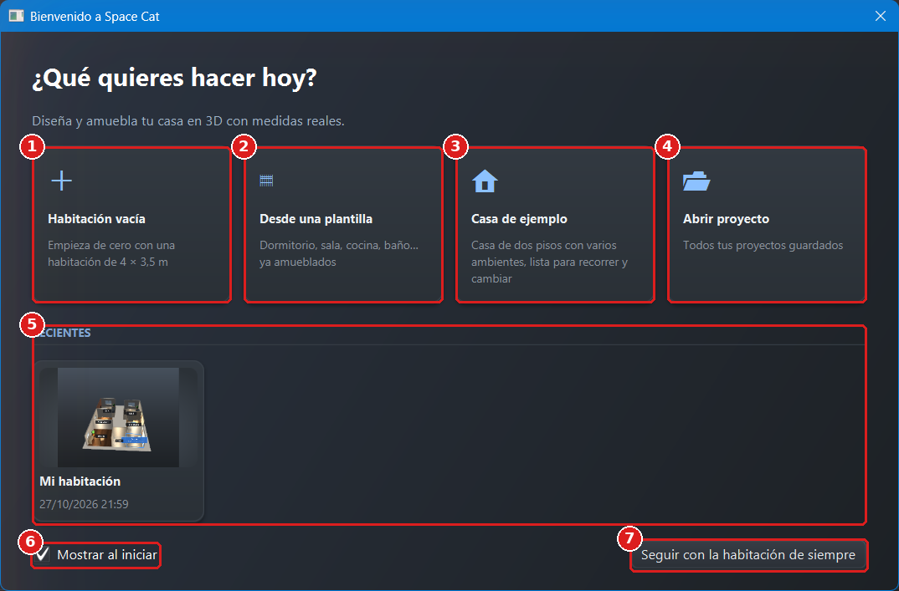

Puedes empezar con una **habitación vacía** de 4 × 3,5 m (1), **desde una plantilla** ya amoblada (2)
o con la **casa de ejemplo** de dos pisos (3), ideal para practicar. También puedes **abrir un
proyecto** (4) o hacer clic en uno **reciente** (5). Si no quieres verla más, desmarca **Mostrar al
iniciar** (6) o pulsa **Seguir con la habitación de siempre** (7). Vuelve con *Ayuda → Pantalla de
bienvenida…*

## 4. La ventana principal

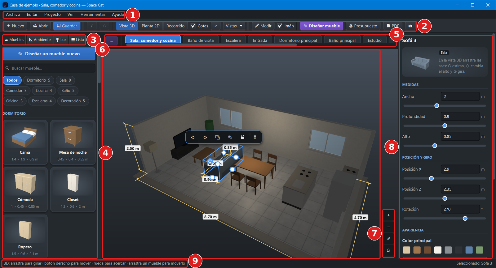

<!-- Tabla: Partes de la ventana principal -->
| N.º | Parte | Qué tiene |
|---|---|---|
| 1 | Menús | *Archivo*, *Editar*, *Proyecto*, *Ver*, *Herramientas*, *Ayuda* |
| 2 | Barra de herramientas | Los botones más usados |
| 3 | Pestañas | **Muebles**, **Ambiente**, **Luz** y **Lista** |
| 4 | Panel izquierdo | Lo de la pestaña elegida |
| 5 | Barra de ambientes | Un botón por habitación |
| 6 | Vista | El diseño en 3D, en planta o en recorrido |
| 7 | Controles de la vista | Acercar, alejar, encuadrar y techo |
| 8 | Propiedades | Medidas, posición y colores de lo seleccionado |
| 9 | Barra de estado | Ayuda del ratón y avisos |

### 4.1 Barra de herramientas

<!-- Tabla: Botones de la barra de herramientas -->
| N.º | Botón | Atajo |
|---|---|---|
| 1 | **Nuevo**, **Abrir**, **Guardar** | `Ctrl+N` · `Ctrl+O` · `Ctrl+S` |
| 2 | Deshacer y rehacer | `Ctrl+Z` · `Ctrl+Y` |
| 3 | **Vista 3D**, **Planta 2D**, **Recorrido** | `Ctrl+1` · `Ctrl+2` · `Ctrl+3` |
| 4 | **Cotas** y encuadrar | `Ctrl+M` · `Ctrl+0` |
| 5 | **Vistas**: guardar un punto de vista | — |
| 6 | **Medir** e **Imán** (pega a las paredes) | `M` · `G` |
| 7 | **Diseñar mueble** (sección 12) | `Ctrl+Shift+D` |
| 8 | **Presupuesto** (sección 13) | `Ctrl+P` |
| 9 | Informe **PDF** | `Ctrl+Shift+P` |
| 10 | Guardar una imagen PNG | `Ctrl+E` |

Si la ventana es angosta, los últimos botones pasan al botón **»**.

### 4.2 El ratón

Un clic selecciona. Arrastrar un mueble lo mueve; arrastrar en el vacío gira la cámara y con el botón
derecho la desplazas. La rueda acerca y aleja.

## 5. Empezar un proyecto

`Ctrl+N` crea una habitación de 4 × 3,5 m.

Arriba están **Casa completa** (1), el ambiente actual (2; clic derecho para renombrarlo) y
**+ Ambiente** (3). Haz clic en una pared, el piso o la ventana (4) para cambiarlos. La guía **Cómo
empezar** (5) te lleva en tres pasos, y los atajos (6) cargan una plantilla o cambian paredes y piso.

## 6. Medidas del ambiente

En la pestaña **Ambiente**, escribe ancho, largo, alto y grosor de muro (1) y pulsa **Aplicar
medidas** (2). Debajo aparece el área.

Más abajo están las superficies para pintar o enchapar (3), las ventanas y puertas (4) y las columnas
(5). Admite de 1 a 30 m de ancho y largo, de 2 a 6 m de alto y muros de 5 a 50 cm.

### 6.1 Ventanas y puertas

**+ Ventana** (1) la pone en el primer lugar libre. **+ Puerta** (2) abre la lista de tipos (3):
normal, principal, doble, corrediza, portón o vano.

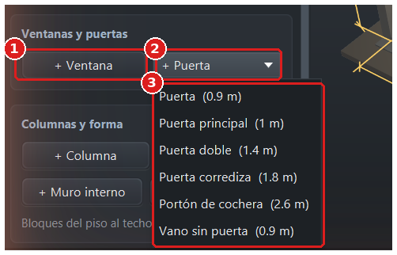

Para cambiar una, haz clic en ella (1). Puedes elegir otro tipo y otra pared (2), moverla o cambiar su
tamaño (3), o quitarla con **Eliminar** (4). Dos aberturas nunca se enciman.

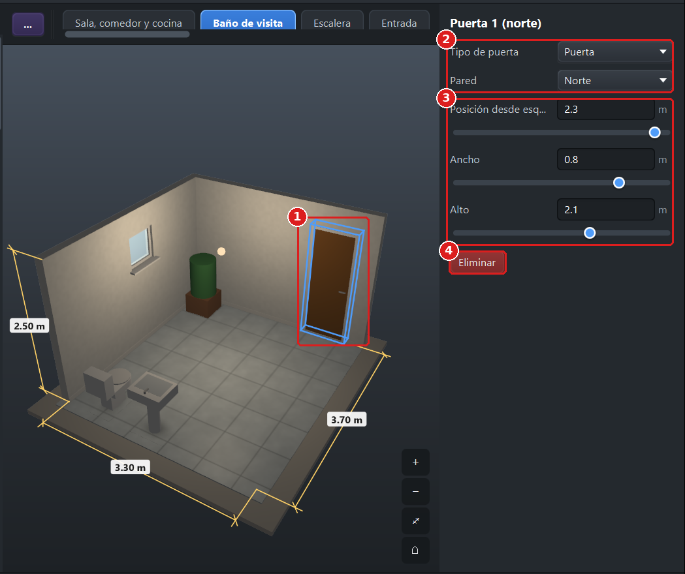

### 6.2 Columnas y forma

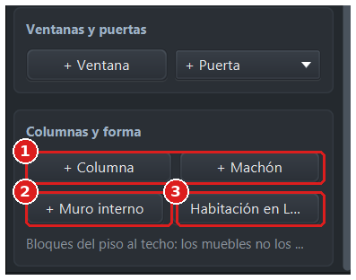

**+ Columna** pone una de 30 × 30 cm y **+ Machón**, una de 40 × 25 cm pegada al muro (1).
**+ Muro interno** (2) divide el ambiente y **Habitación en L…** (3) le quita una esquina.

## 7. Paredes, piso y techo

Pulsa **Norte**, **Sur**, **Piso**… (1) o haz clic en la pared; se marca en azul (2). Elige el
**Material** (3) y el **Color** (4). **Aplicar a todas** (5) lo copia a las cuatro paredes.

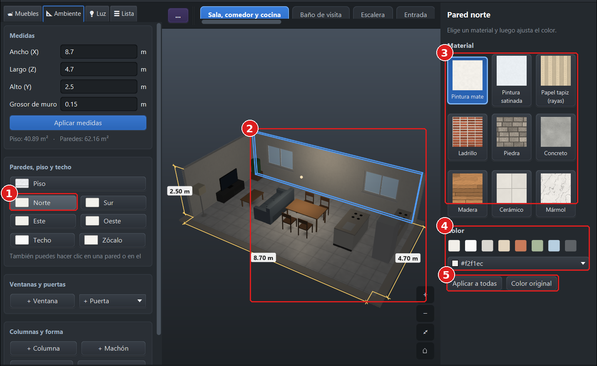

Hay pintura, papel tapiz, ladrillo, piedra, madera, cerámico, mármol y más, con texturas a escala real.

## 8. Muebles

### 8.1 Agregar

En **Muebles**, elige una categoría (3) o busca por nombre (2). Un clic en la tarjeta (5) pone el
mueble en un lugar libre; si la arrastras, queda donde la sueltes. **Diseñar un mueble nuevo** (1)
abre el diseñador.

### 8.2 Mover, girar y cambiar medidas

Haz clic en el mueble. Aparece una barra flotante (1) para girar, duplicar, bloquear o eliminar. En
el marco azul (2), los círculos estiran, el rombo cambia el alto y la flecha gira. Para medidas
exactas, escribe en **Medidas** (3) y **Posición y giro** (4); los colores están en **Apariencia** (5).

<!-- Tabla: Atajos para mover y girar -->
| Acción | Cómo |
|---|---|
| Mover | Arrastrar · flechas (5 cm) · `Shift` + flechas (1 cm) |
| Girar | `R` (90°) · `Q` / `E` (15°) |
| Duplicar / eliminar | `Ctrl+D` / `Supr` |
| Bloquear | `L` |
| Imán | `G`; mantén `Alt` para soltarlo |

### 8.3 Varios a la vez

`Ctrl+A` selecciona todos, `Ctrl` + clic suma uno y `Shift` + arrastrar dibuja un rectángulo. El panel
(2) gira, duplica, elimina o bloquea todos juntos.

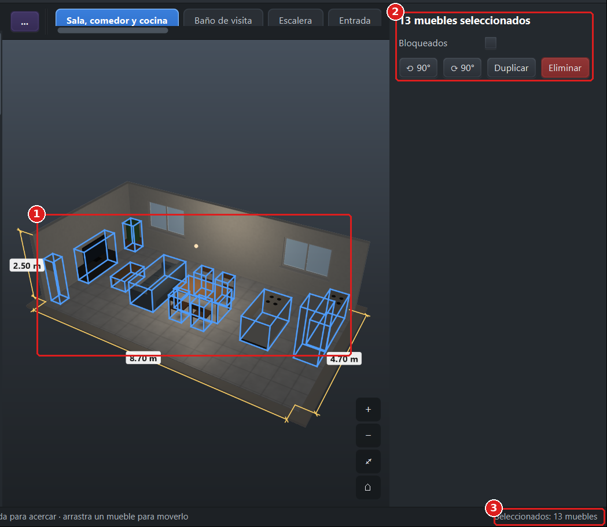

### 8.4 Pestaña Lista

Sirve para encontrar objetos pequeños o tapados: elige uno de la lista (3) y sus propiedades se abren
a la derecha (4).

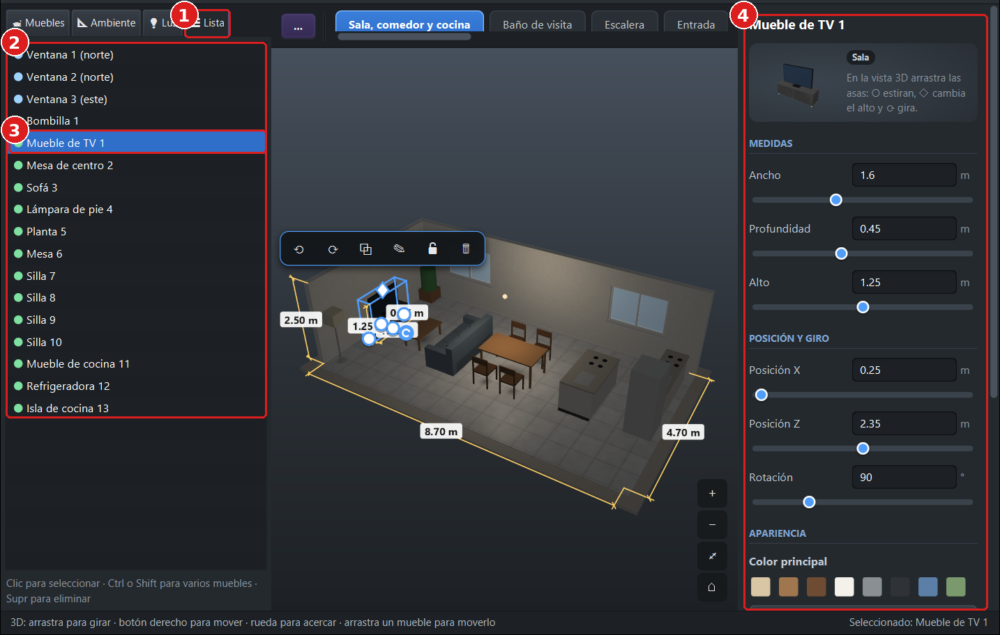

### 8.5 Importar un modelo 3D

*Archivo → Importar modelo 3D (.glb/.gltf)…* (`Ctrl+I`).

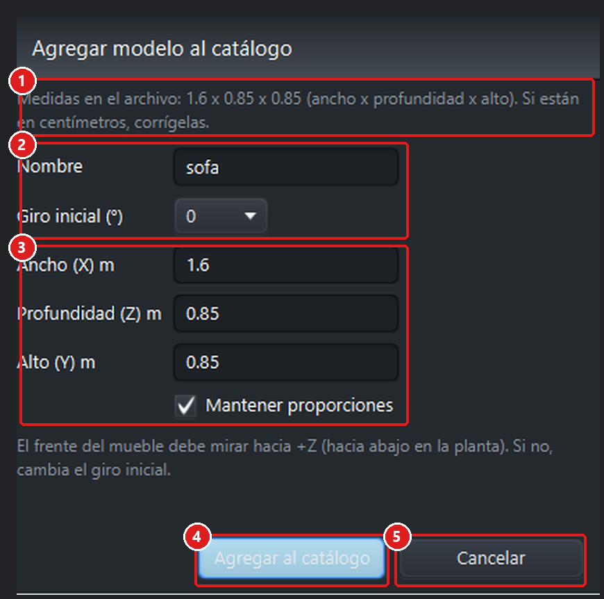

Si las medidas del archivo (1) salen enormes, el modelo está en centímetros: corrígelas en (3). Ponle
nombre y giro inicial (2) y pulsa **Agregar al catálogo** (4). Aparecerá en **Muebles** con la
etiqueta *3D*. No se admiten modelos comprimidos con Draco o Meshopt.

## 9. Luces

En la pestaña **Luz**, agrega una **Bombilla**, un **Foco** o un **Sol** (3) y pulsa **Noche** (1)
para ver el efecto. Haz clic en la luz (4) para cambiar color e intensidad (5). La **luz ambiental** (2)
da la claridad general.

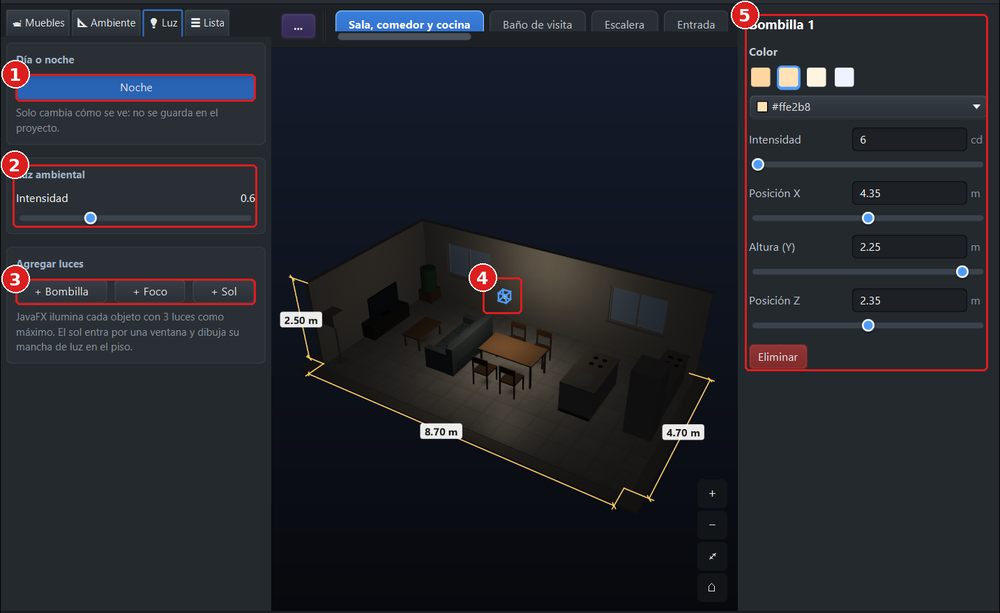

## 10. Casa con varios ambientes

Pulsa **Casa completa** (`Ctrl+4`) o el botón **…** (1).

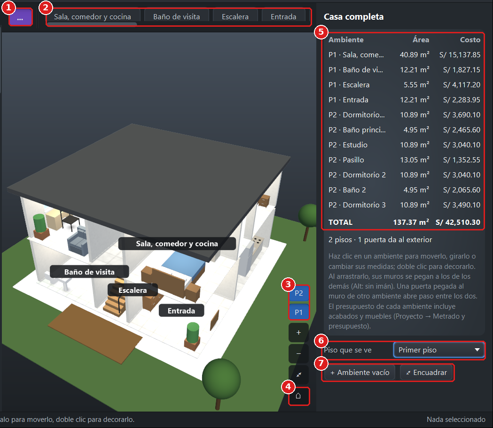

Haz clic en un ambiente (2) para decorarlo, o arrástralo: los muros se pegan solos. **P1** y **P2** (3)
muestran u ocultan cada piso y (4) pone o quita el techo. La tabla (5) da el área y el costo de cada
ambiente. También puedes elegir el piso visible (6), agregar un ambiente o encuadrar (7).

Para ver el primer piso por dentro, quita el techo y apaga **P2**. Esto solo cambia lo que se ve; no
borra nada.

## 11. Ver y recorrer

**Planta 2D** (`Ctrl+2`) muestra el plano desde arriba con las cotas en amarillo; `Ctrl+M` las oculta.

**Recorrido** (`Ctrl+3`) te deja caminar a la altura de los ojos: `W`/`S` avanzas, `A`/`D` vas de
costado, ←/→ giras y `Shift` corres. No se atraviesan paredes ni muebles.

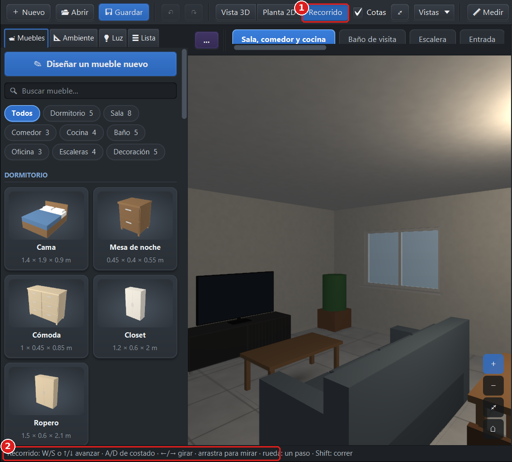

## 12. Diseñador de muebles

Abre **Diseñar mueble** (`Ctrl+Shift+D`), ponle nombre (1) y elige de qué mueble partir (2). Agrega
piezas (4), elige cada una en la lista (5) y ajústala en (8). Al terminar, **Guardar en el catálogo**
(9): quedará en *Mis diseños*.

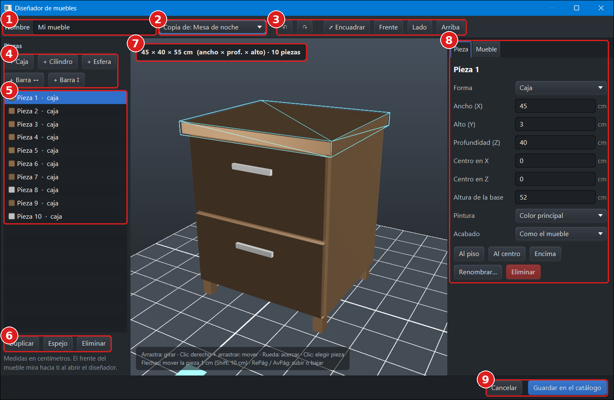

Las vistas (3) te dejan verlo de frente, de lado o desde arriba; (6) duplica, refleja o borra la pieza
y (7) muestra el tamaño total en cm.

## 13. Presupuesto e informe PDF

Pulsa **Presupuesto** (`Ctrl+P`).

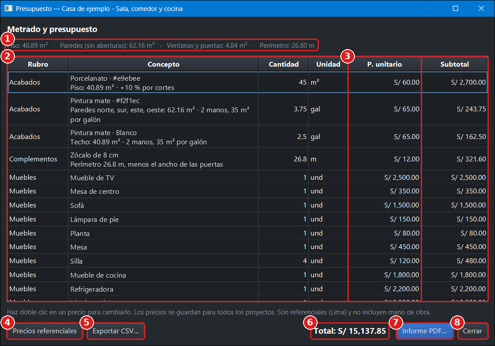

Arriba está el resumen de m² (1) y abajo una fila por material o mueble (2). Haz doble clic en el
precio (3) para poner el de tu ferretería; **Precios referenciales** (4) los restaura. El **Total** (6)
está en soles. Puedes llevarlo a Excel con **Exportar CSV…** (5) o sacar un **Informe PDF…** (7) con
planta, vista 3D, muebles y presupuesto.

La pintura se calcula en galones para dos manos y los pisos con 10 % de desperdicio. Los precios son
referenciales (Lima, 2026) y no incluyen mano de obra (anexo B).

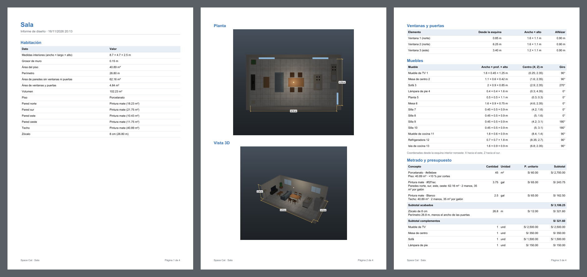

## 14. Guardar y abrir

El menú **Archivo** tiene lo necesario para empezar o abrir (1), guardar (2), llevar el proyecto a otra
PC como `.amob3d` (3), guardar una imagen (4) e importar modelos 3D (5).

`Ctrl+S` guarda; la primera vez pide un nombre.

`Ctrl+O` abre. Elige el proyecto (1); ahí mismo puedes renombrarlo o eliminarlo (2).

`Ctrl+Shift+N` parte de una plantilla: dormitorio, sala, comedor, cocina, baño u oficina (1), con su
vista previa (2).

Si hay cambios sin guardar, Space Cat hace una copia cada minuto. Si se cierra de golpe, al abrirla te
ofrece **recuperar** el trabajo.

## 15. Tutoriales

### 15.1 Dormitorio de 3,5 × 3 m

1. `Ctrl+N` y, en **Ambiente**: ancho `3.5`, largo `3`, alto `2.5` → **Aplicar medidas**.
2. **+ Puerta → Puerta** en la pared **Sur** y **+ Ventana** en la **Norte**.
3. En **Muebles → Dormitorio**, agrega **Cama**, dos **Mesas de noche** y un **Closet**.
4. Lleva la cama a la pared norte con las mesas a sus lados; gira el closet con `R`.
5. Ponle **Papel tapiz** a la pared norte.
6. Recórrelo con `Ctrl+3` y guárdalo como *Mi dormitorio*.

### 15.2 Casa de dos pisos

1. Empieza con **Habitación vacía** y las medidas de la sala.
2. **+ Ambiente → desde una plantilla → Dormitorio**.
3. En `Ctrl+4`, cambia su **Piso** a *Segundo piso* y arrástralo encima de la sala.
4. En la sala, agrega una **Escalera en L** (categoría **Escaleras**).
5. Usa **P1**, **P2** y el techo para verla.

### 15.3 Presupuesto de pintura

1. Clic en una pared → **Pintura mate** → **Aplicar a todas**.
2. En `Ctrl+P`, la fila de pintura muestra m² y galones.
3. Cambia el precio y exporta a CSV o PDF.

## 16. Avisos

Si algo no se puede hacer, aparece un aviso rojo sobre la vista (1) que también queda en la barra de
estado (3). Aquí, el closet (2) ya no entraba.

Cuando hay que decidir, sale una ventana. Por ejemplo, al cerrar sin guardar: **Guardar** (1), **No
guardar** (2) o **Cancelar** (3).

<!-- Tabla: Avisos y qué hacer -->
| Aviso | Qué hacer |
|---|---|
| *No hay espacio libre para …* | Mover o achicar otros muebles, o agrandar el ambiente |
| *Choca con …* / *Bloquea el paso de …* | Moverlo, o mantener `Alt` para soltar el imán |
| *No cabe dentro de la habitación* | Acercarlo al centro o achicarlo |
| *Es más alto (…) que la habitación* | Bajar el mueble o subir el alto del ambiente |
| *… ya no cabía y se eliminó* | `Ctrl+Z` si fue un error |
| *… está bloqueado* | Pulsar `L` |
| *Ya existe un proyecto llamado …* | Usar otro nombre |
| *El archivo no es un modelo glTF válido* | Probar con otro modelo |
| *Agrega una puerta principal…* | Poner una puerta en una pared exterior |
| *No se pudo exportar* | Cerrar el archivo en el otro programa o elegir otra carpeta |
| *No se pudo abrir la base de datos* | Cerrar la otra ventana de Space Cat |
| *Algo salió mal* | *Ayuda → Abrir registro de errores* y enviar `amoblador3d-0.log` por WhatsApp al 919 192 008 |

Otros casos: si no ves el techo, solo aparece en el **Recorrido** o con su botón en **Casa completa**;
si la vista 3D se ve negra o lenta, actualiza el controlador de video.

## 17. Atajos de teclado

`F1` muestra todos.

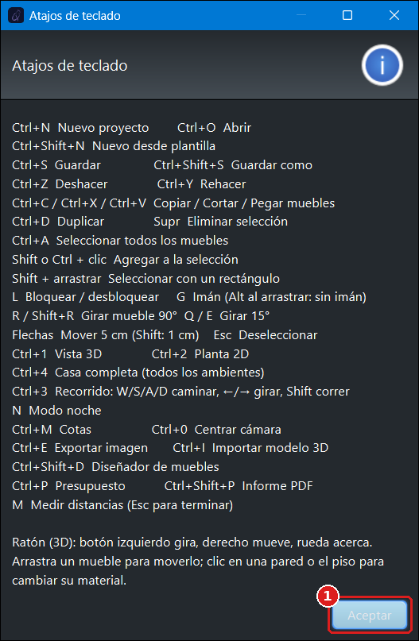

<!-- Tabla: Atajos más usados -->
| Tecla | Acción |
|---|---|
| `Ctrl+N` / `Ctrl+O` / `Ctrl+S` | Nuevo / Abrir / Guardar |
| `Ctrl+Z` / `Ctrl+Y` | Deshacer / Rehacer |
| `R` · `Q` / `E` | Girar 90° · 15° |
| `Supr` / `Ctrl+D` | Eliminar / Duplicar |
| `L` / `G` | Bloquear / Imán |
| `Ctrl+1` / `2` / `3` / `4` | 3D / Planta / Recorrido / Casa completa |
| `N` | Modo noche |
| `Ctrl+P` / `Ctrl+Shift+P` | Presupuesto / Informe PDF |
| `F11` | Pantalla completa |

## 18. Tus datos

*Ayuda → Acerca de Space Cat* muestra la versión y la carpeta donde se guardan tus proyectos (1). Copia
esa carpeta para tener un respaldo.

## 19. Consejos

- Mide antes de dibujar: ancho, largo, alto y dónde están puertas y ventanas.
- Pon primero puertas y ventanas, luego los muebles grandes y al final los pequeños.
- Bloquea (`L`) lo que ya está bien.
- Recorre (`Ctrl+3`) para ver si se puede pasar.
- Guarda seguido y exporta una copia `.amob3d`.
- Antes de comprar, cambia los precios por los de tu ferretería.

## 20. Glosario

<!-- Tabla: Glosario -->
| Término | Significado |
|---|---|
| Alféizar | Altura del piso al borde inferior de la ventana |
| Ambiente | Cada habitación |
| Cota | Medida dibujada en el plano |
| Machón | Columna pegada a un muro |
| Metrado | Cálculo de m² y metros de material |
| Planta | Vista desde arriba |
| Vano | Abertura sin puerta |
| Zócalo | Franja al pie de la pared |

## Anexo A. Catálogo de muebles paramétricos

Las medidas se cambian en **Medidas** dentro de estos rangos. Las escaleras se ajustan solas al alto
del ambiente.

<!-- Tabla: Muebles paramétricos con sus medidas iniciales y rangos -->
| Categoría | Mueble | Medidas iniciales, ancho × prof. × alto (m) | Rango de ancho (m) | Rango de prof. (m) | Rango de alto (m) | Color secundario |
|---|---|---|---|---|---|---|
| Dormitorio | Cama | 1,40 × 1,90 × 0,90 | 0,8–2,2 | 1,8–2,3 | 0,5–1,4 | Frazada |
| Dormitorio | Mesa de noche | 0,45 × 0,40 × 0,55 | 0,3–0,7 | 0,3–0,6 | 0,4–0,8 | Frentes de cajones |
| Dormitorio | Cómoda | 1,00 × 0,45 × 0,85 | 0,6–2,0 | 0,35–0,6 | 0,6–1,3 | Frentes de cajones |
| Dormitorio | Closet | 1,20 × 0,60 × 2,00 | 0,5–3,0 | 0,4–0,8 | 1,2–2,6 | Puertas |
| Dormitorio | Ropero | 1,50 × 0,60 × 2,10 | 0,8–3 | 0,5–0,75 | 1,8–2,5 | Puertas |
| Sala | Sofá | 2,00 × 0,90 × 0,85 | 1,2–3,2 | 0,7–1,1 | 0,7–1,1 | Cojines |
| Sala | Mueble de TV | 1,60 × 0,45 × 1,25 | 1,0–2,6 | 0,35–0,6 | 0,9–1,6 | Puertas |
| Sala | Librero | 0,80 × 0,30 × 1,80 | 0,4–2,4 | 0,2–0,5 | 0,6–2,4 | Fondo |
| Sala | Mesa de centro | 1,10 × 0,60 × 0,42 | 0,6–1,6 | 0,4–0,9 | 0,3–0,55 | Tapa |
| Sala | Sillón | 0,90 × 0,90 × 0,85 | 0,7–1,2 | 0,7–1,0 | 0,7–1,0 | Cojines |
| Sala | Lámpara de pie | 0,40 × 0,40 × 1,60 | 0,3–0,6 | 0,3–0,6 | 1,2–1,9 | Pantalla |
| Sala | Televisor | 1,20 × 0,08 × 0,70 | 0,6–2,0 | 0,05–0,12 | 0,4–1,2 | Pantalla |
| Comedor | Mesa | 1,20 × 0,80 × 0,75 | 0,4–3,0 | 0,4–1,5 | 0,4–1,1 | Patas |
| Comedor | Silla | 0,45 × 0,50 × 0,90 | 0,35–0,7 | 0,35–0,7 | 0,7–1,2 | Asiento |
| Comedor | Aparador | 1,60 × 0,45 × 0,85 | 0,9–2,4 | 0,35–0,6 | 0,7–1,1 | Puertas |
| Cocina | Mueble de cocina | 1,80 × 0,60 × 0,90 | 0,6–4,0 | 0,5–0,7 | 0,8–1,0 | Encimera |
| Cocina | Refrigeradora | 0,70 × 0,70 × 1,80 | 0,5–1,0 | 0,55–0,8 | 1,2–2,1 | Tiradores |
| Cocina | Isla de cocina | 1,60 × 0,90 × 0,90 | 1,0–2,6 | 0,6–1,1 | 0,85–1,0 | Encimera |
| Cocina | Alacena | 1,20 × 0,35 × 0,70 | 0,6–2,4 | 0,3–0,5 | 0,5–0,9 | Puertas |
| Baño | Inodoro | 0,40 × 0,70 × 0,75 | 0,35–0,5 | 0,6–0,8 | 0,65–0,85 | Asiento |
| Baño | Lavatorio | 0,55 × 0,45 × 0,85 | 0,4–0,8 | 0,35–0,6 | 0,75–0,95 | Grifería |
| Baño | Tina | 1,60 × 0,75 × 0,55 | 1,2–1,9 | 0,65–0,85 | 0,45–0,65 | Interior |
| Baño | Ducha | 0,90 × 0,90 × 2,10 | 0,7–1,4 | 0,7–1,4 | 1,9–2,3 | Mampara |
| Baño | Espejo | 0,80 × 0,05 × 0,60 | 0,4–1,4 | 0,03–0,1 | 0,4–1,0 | Marco |
| Oficina | Escritorio | 1,20 × 0,60 × 0,75 | 0,8–2,4 | 0,45–0,9 | 0,65–0,9 | Frentes de cajones |
| Oficina | Silla de oficina | 0,60 × 0,60 × 1,10 | 0,5–0,75 | 0,5–0,75 | 0,9–1,3 | Asiento |
| Oficina | Estante | 0,90 × 0,30 × 1,80 | 0,4–2,4 | 0,2–0,5 | 0,6–2,4 | Fondo |
| Escaleras | Escalera recta | 0,90 × 3,60 × 2,50 | 0,6–2,0 | 1,2–7,0 | 0,4–6,0 | Pasamanos |
| Escaleras | Escalera en L | 2,00 × 2,60 × 2,50 | 1,4–4,0 | 1,4–5,0 | 0,8–6,0 | Pasamanos |
| Escaleras | Escalera de caracol | 1,60 × 1,60 × 2,50 | 1,1–2,6 | 1,1–2,6 | 0,8–6,0 | Peldaños |
| Escaleras | Baranda | 1,50 × 0,06 × 0,90 | 0,3–8,0 | 0,04–0,2 | 0,6–1,2 | Pasamanos |
| Decoración | Planta | 0,50 × 0,50 × 1,10 | 0,3–1,0 | 0,3–1,0 | 0,5–2,0 | Follaje |
| Decoración | Maceta | 0,40 × 0,40 × 0,60 | 0,25–0,8 | 0,25–0,8 | 0,3–1,2 | Follaje |
| Decoración | Alfombra | 2,00 × 1,40 × 0,02 | 0,8–3,5 | 0,6–2,5 | 0,01–0,05 | Borde |
| Decoración | Cuadro | 0,80 × 0,04 × 0,60 | 0,3–1,6 | 0,03–0,08 | 0,3–1,2 | Marco |
| Decoración | Cortina | 1,50 × 0,06 × 2,00 | 0,6–3,0 | 0,04–0,12 | 1,2–2,6 | Tela |

## Anexo B. Materiales y precios de referencia

<!-- Tabla: Materiales de acabado, superficies permitidas, unidad de compra y precio de referencia -->
| Material | Paredes | Piso | Techo | Se compra en | Precio de referencia (S/) |
|---|---|---|---|---|---|
| Pintura mate | Sí | No | Sí | Galones (2 manos, 35 m² por galón) | 65,00 por galón |
| Pintura satinada | Sí | No | Sí | Galones (2 manos, 35 m² por galón) | 85,00 por galón |
| Papel tapiz | Sí | No | No | Rollos de 5,3 m², +10 % para empalmes | 45,00 por rollo |
| Ladrillo | Sí | No | No | m², +10 % por cortes | 55,00 por m² |
| Piedra | Sí | Sí | No | m², +10 % por cortes | 70,00 por m² |
| Concreto | Sí | Sí | Sí | m², +10 % por cortes | 60,00 por m² |
| Madera | Sí | Sí | Sí | m², +10 % por cortes | 90,00 por m² |
| Cerámico | Sí | Sí | No | m², +10 % por cortes | 35,00 por m² |
| Mármol | Sí | Sí | No | m², +10 % por cortes | 180,00 por m² |
| Porcelanato | No | Sí | No | m², +10 % por cortes | 60,00 por m² |
| Alfombra | No | Sí | No | m², +10 % por cortes | 40,00 por m² |
| Zócalo | — | — | — | Metros lineales, sin el ancho de las puertas | 12,00 por m |

<!-- Tabla: Precios de referencia de los muebles paramétricos -->
| Mueble | Precio (S/) | Mueble | Precio (S/) |
|---|---|---|---|
| Cama | 900,00 | Mueble de cocina | 1 800,00 |
| Mesa de noche | 180,00 | Refrigeradora | 2 200,00 |
| Cómoda | 600,00 | Inodoro | 350,00 |
| Closet | 1 200,00 | Lavatorio | 250,00 |
| Sofá | 1 500,00 | Escritorio | 400,00 |
| Mueble de TV | 2 500,00 | Escalera recta | 3 500,00 |
| Librero | 350,00 | Escalera en L | 5 200,00 |
| Mesa | 450,00 | Escalera de caracol | 4 800,00 |
| Silla | 120,00 | Baranda | 300,00 |

## Anexo C. Medidas iniciales de las aberturas

<!-- Tabla: Medidas iniciales de cada tipo de abertura -->
| Tipo | Ancho (m) | Alto (m) | Alféizar (m) |
|---|---|---|---|
| Ventana | 1,20 | 1,00 | 0,90 |
| Puerta normal | 0,90 | 2,10 | 0 |
| Puerta principal | 1,00 | 2,20 | 0 |
| Puerta doble | 1,40 | 2,20 | 0 |
| Puerta corrediza | 1,80 | 2,10 | 0 |
| Portón de cochera | 2,60 | 2,20 | 0 |
| Vano sin puerta | 0,90 | 2,10 | 0 |

