# Manual de usuario

## 1. Introducción

### 1.1 Propósito

Este manual enseña a usar Space Cat 2.1.0, paso a paso y con capturas reales: diseñar y amoblar
ambientes con medidas reales, verlos en 3D y obtener el presupuesto.

### 1.2 A quién va dirigido

A cualquier persona, sin conocimientos de arquitectura ni de programas de diseño. La instalación está
en el manual de instalación de Space Cat.

### 1.3 Cómo leer las capturas

Cada captura tiene **recuadros rojos numerados**. La tabla que sigue a la captura dice qué es cada
número y para qué sirve.

<!-- Tabla: Convenciones del manual -->
| Convención | Significado | Ejemplo |
|---|---|---|
| **Negrita** | Botón, pestaña o campo de la pantalla | Pulse **Aplicar medidas** |
| *Menú → Opción* | Ruta dentro de un menú | *Archivo → Guardar* |
| `Ctrl+S` | Atajo de teclado | `Ctrl+Z` deshace |

Las medidas van en **metros** (2.5 o 2,5); en el Diseñador de muebles, en **centímetros**. Los precios
están en **soles (S/)**.

## 2. Qué es Space Cat

Space Cat sirve para decidir cómo amoblar una vivienda **antes de comprar**: se dibujan los ambientes
con sus medidas, se colocan puertas, ventanas y muebles, se ve el resultado en 3D y se obtiene el
presupuesto. Un mueble **nunca atraviesa una pared ni tapa una puerta**: si no entra en la realidad,
tampoco entra en Space Cat. Funciona sin internet.

<!-- Tabla: Requisitos mínimos del equipo -->
| Elemento | Mínimo |
|---|---|
| Sistema operativo | Windows 10 u 11 de 64 bits |
| Memoria | 4 GB de RAM |
| Video | Cualquier tarjeta con aceleración 3D |
| Espacio en disco | 300 MB |

**Instalar:** doble clic en `SpaceCat-2.1.0.exe` → **Next** → **Next** → **Install** → **Finish**. Si Windows
muestra *«Windows protegió su PC»*: *Más información → Ejecutar de todas formas*. Cada pantalla está
en el manual de instalación.

## 3. Inicio rápido (5 minutos)

1. Abra Space Cat y elija **Casa de ejemplo**.
2. Haga clic en **Sala, comedor y cocina**.
3. En **Muebles**, haga clic en un mueble: aparece en un lugar libre.
4. Arrástrelo con el ratón; `R` lo gira.
5. `Ctrl+3` para caminar por dentro con `W` `A` `S` `D`.
6. `Ctrl+P` para ver el presupuesto.
7. `Ctrl+S` para guardar.

## 4. Pantalla de bienvenida

Aparece al abrir la aplicación.

<!-- Tabla: Partes de la pantalla de bienvenida -->
| N.º | Qué es | Para qué sirve |
|---|---|---|
| 1 | **Habitación vacía** | Empezar de cero con una habitación de 4 × 3,5 m |
| 2 | **Desde una plantilla** | Partir de un dormitorio, sala, cocina, baño… ya amoblado |
| 3 | **Casa de ejemplo** | Casa de dos pisos lista para practicar (recomendado la primera vez) |
| 4 | **Abrir proyecto** | Seguir con un proyecto guardado |
| 5 | **Recientes** | Clic en la miniatura para abrir el último proyecto |
| 6 | **Mostrar al iniciar** | Desmarcar para no ver más esta pantalla |
| 7 | **Seguir con la habitación de siempre** | Ir directo a la ventana principal |

Se vuelve a abrir en *Ayuda → Pantalla de bienvenida…*.

## 5. La ventana principal

<!-- Tabla: Partes de la ventana principal -->
| N.º | Qué es | Para qué sirve |
|---|---|---|
| 1 | **Barra de menús** | Todas las funciones: *Archivo*, *Editar*, *Proyecto*, *Ver*, *Herramientas*, *Ayuda* |
| 2 | **Barra de herramientas** | Botones de uso frecuente (figura siguiente) |
| 3 | **Pestañas** | **Muebles**, **Ambiente**, **Luz** y **Lista** |
| 4 | **Panel izquierdo** | Contenido de la pestaña elegida (aquí, el catálogo) |
| 5 | **Barra de ambientes** | Un botón por habitación; clic para entrar a decorarla |
| 6 | **Vista** | El diseño en 3D, en planta o en recorrido |
| 7 | **Controles de la vista** | Acercar, alejar, encuadrar y techo |
| 8 | **Propiedades** | Medidas, posición y colores de lo que está seleccionado |
| 9 | **Barra de estado** | Ayuda del ratón y avisos |

### 5.1 Barra de herramientas

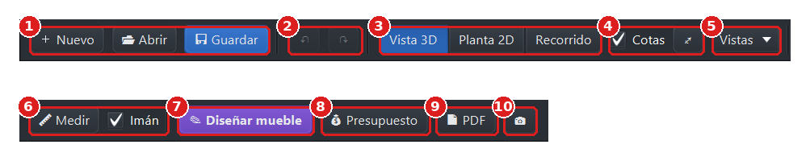

<!-- Tabla: Botones de la barra de herramientas -->
| N.º | Botón | Para qué sirve | Atajo |
|---|---|---|---|
| 1 | **Nuevo**, **Abrir**, **Guardar** | Manejar proyectos | `Ctrl+N` · `Ctrl+O` · `Ctrl+S` |
| 2 | Flechas | Deshacer y rehacer | `Ctrl+Z` · `Ctrl+Y` |
| 3 | **Vista 3D**, **Planta 2D**, **Recorrido** | Cambiar la forma de ver | `Ctrl+1` · `Ctrl+2` · `Ctrl+3` |
| 4 | **Cotas** y encuadrar | Mostrar medidas; centrar la cámara | `Ctrl+M` · `Ctrl+0` |
| 5 | **Vistas** | Guardar y volver a un punto de vista | — |
| 6 | **Medir** e **Imán** | Medir distancias; pegar muebles a paredes | `M` · `G` |
| 7 | **Diseñar mueble** | Crear un mueble propio (sección 13) | `Ctrl+Shift+D` |
| 8 | **Presupuesto** | Metrado y costos (sección 14) | `Ctrl+P` |
| 9 | **PDF** | Informe para imprimir | `Ctrl+Shift+P` |
| 10 | Cámara | Guardar una imagen PNG de la vista | `Ctrl+E` |

Si la ventana es angosta, los últimos botones pasan al botón **»** de la derecha.

### 5.2 Uso del ratón

<!-- Tabla: Acciones con el ratón -->
| Acción | Resultado |
|---|---|
| Clic | Selecciona un mueble, pared, puerta o luz |
| Arrastrar un mueble | Lo mueve |
| Arrastrar en el vacío | Gira la cámara |
| Botón derecho + arrastrar | Desplaza la cámara |
| Rueda | Acerca o aleja |

## 6. Empezar un proyecto

*Archivo → Nuevo proyecto* (`Ctrl+N`) crea una habitación de 4 × 3,5 m.

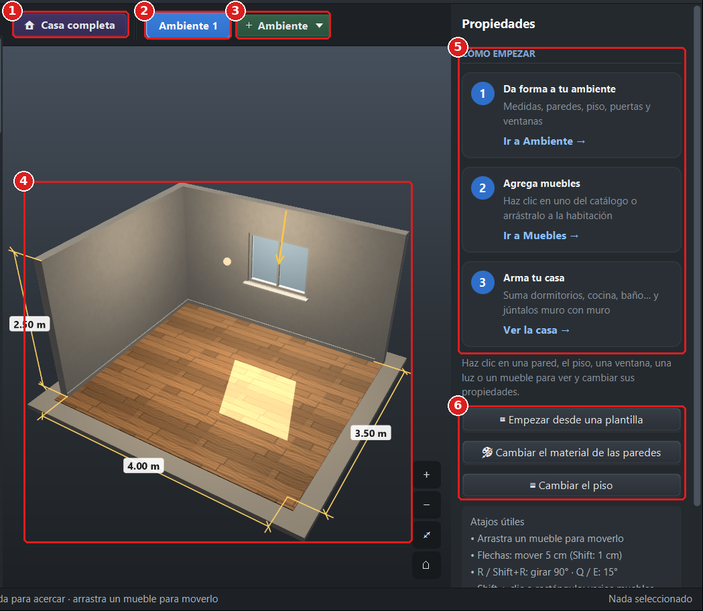

<!-- Tabla: Partes de un proyecto nuevo -->
| N.º | Qué es | Para qué sirve |
|---|---|---|
| 1 | **Casa completa** | Ver todos los ambientes juntos (sección 11) |
| 2 | **Ambiente 1** | El ambiente actual; clic derecho para renombrarlo |
| 3 | **+ Ambiente** | Agregar otra habitación |
| 4 | Habitación | Clic en una pared, el piso o la ventana para cambiarlos |
| 5 | **Cómo empezar** | Tres pasos guiados: Ambiente, Muebles y Casa |
| 6 | Atajos | Cargar una plantilla o cambiar paredes y piso |

## 7. Medidas del ambiente

1. Pestaña **Ambiente**.
2. Escriba **Ancho**, **Largo**, **Alto** y **Grosor de muro** (1).
3. Pulse **Aplicar medidas** (2).

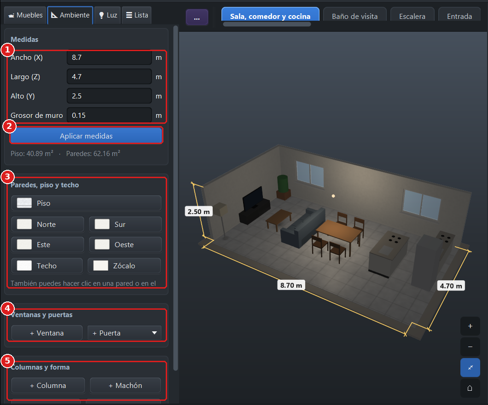

<!-- Tabla: Partes de la pestaña Ambiente -->
| N.º | Qué es | Para qué sirve |
|---|---|---|
| 1 | **Medidas** | Ancho, largo y alto **interiores**, y grosor de muro |
| 2 | **Aplicar medidas** | Aplica los valores escritos; debajo se ve el área |
| 3 | **Paredes, piso y techo** | Elegir la superficie a pintar o enchapar (sección 8) |
| 4 | **Ventanas y puertas** | Agregar aberturas (sección 7.1) |
| 5 | **Columnas y forma** | Columnas, muros y forma en L (sección 7.2) |

Rangos: ancho y largo de 1 a 30 m; alto de 2 a 6 m; muro de 5 a 50 cm.

### 7.1 Ventanas y puertas

<!-- Tabla: Botones para agregar ventanas y puertas -->
| N.º | Qué es | Para qué sirve |
|---|---|---|
| 1 | **+ Ventana** | Agrega una ventana en el primer lugar libre |
| 2 | **+ Puerta** | Abre la lista de tipos de puerta |
| 3 | Tipos de puerta | Normal, principal, doble, corrediza, portón o vano sin puerta, con su ancho |

**Agregar una puerta:** **+ Puerta** (2) → elija el tipo (3). Aparece en el primer lugar libre.

**Cambiarla:** haga clic en la puerta o ventana:

<!-- Tabla: Propiedades de una puerta -->
| N.º | Qué es | Para qué sirve |
|---|---|---|
| 1 | Puerta seleccionada | Se marca en azul |
| 2 | **Tipo de puerta** y **Pared** | Cambiar el tipo y la pared donde está |
| 3 | Posición, ancho y alto | Moverla y cambiar su tamaño |
| 4 | **Eliminar** | Quitarla |

Dos aberturas nunca se enciman: si el lugar está ocupado, la aplicación lo avisa.

### 7.2 Columnas y forma

<!-- Tabla: Botones de columnas y forma -->
| N.º | Qué es | Para qué sirve |
|---|---|---|
| 1 | **+ Columna** / **+ Machón** | Columna de 30 × 30 cm / columna de 40 × 25 cm pegada al muro |
| 2 | **+ Muro interno** | Muro de 1,5 m que divide el ambiente |
| 3 | **Habitación en L…** | Quitar una esquina del ambiente |

## 8. Paredes, piso y techo

1. Pestaña **Ambiente** → pulse **Norte**, **Sur**, **Piso**… (1), o haga clic en la pared.
2. Elija el **Material** (3).
3. Elija el **Color** (4).

<!-- Tabla: Cambiar el material de una superficie -->
| N.º | Qué es | Para qué sirve |
|---|---|---|
| 1 | Botón de la pared | Elegir la superficie |
| 2 | Pared marcada | Muestra en azul cuál se está cambiando |
| 3 | **Material** | Pintura, papel tapiz, ladrillo, piedra, madera, cerámico, mármol… |
| 4 | **Color** | Tiñe el material |
| 5 | **Aplicar a todas** / **Color original** | Copiar a las cuatro paredes / volver al color inicial |

Las texturas están a escala real.

## 9. Muebles

### 9.1 Agregar un mueble

1. Pestaña **Muebles**.
2. Elija la categoría (3) o escriba el nombre (2).
3. Clic en la tarjeta (5): el mueble aparece en un lugar libre.

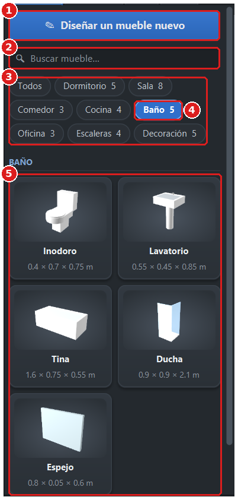

<!-- Tabla: Partes del catálogo -->
| N.º | Qué es | Para qué sirve |
|---|---|---|
| 1 | **Diseñar un mueble nuevo** | Crear un mueble propio (sección 13) |
| 2 | **Buscar mueble…** | Escribir el nombre (no importan tildes ni mayúsculas) |
| 3 | Categorías | Filtrar; el número dice cuántos hay |
| 4 | Categoría elegida | Queda en azul (aquí, **Baño**) |
| 5 | Tarjetas | **Clic**: agrega el mueble en un lugar libre. **Arrastrar**: lo deja donde se suelta |

### 9.2 Mover, girar y cambiar medidas

Haga clic en el mueble. Para moverlo, arrástrelo; para medidas exactas, escriba en (3) y (4).

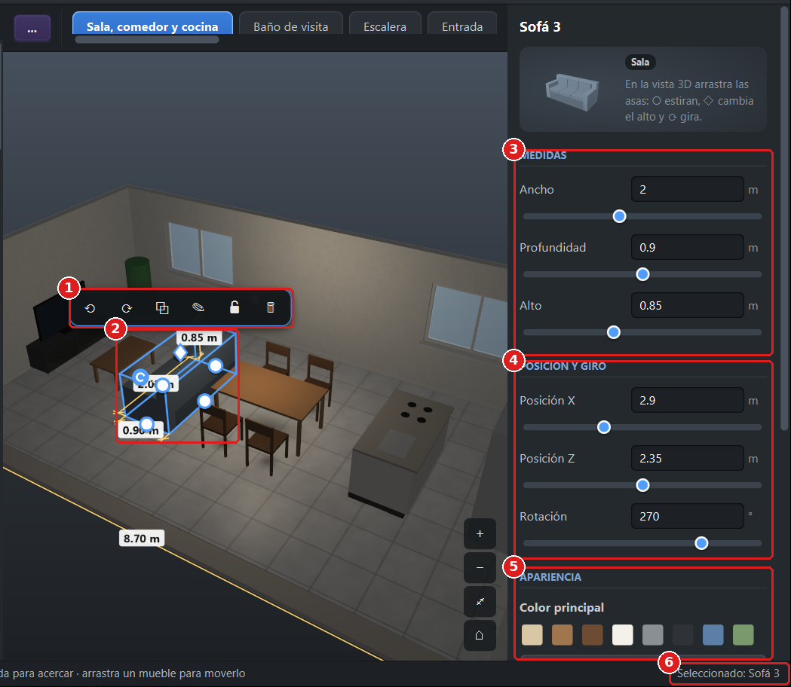

<!-- Tabla: Mueble seleccionado -->
| N.º | Qué es | Para qué sirve |
|---|---|---|
| 1 | **Barra flotante** | Girar, duplicar, diseñar a partir de él, bloquear y eliminar |
| 2 | Marco azul y asas | Los círculos estiran, el rombo cambia el alto, la flecha gira |
| 3 | **Medidas** | Ancho, profundidad y alto |
| 4 | **Posición y giro** | Mover con números exactos |
| 5 | **Apariencia** | Colores y acabado |
| 6 | Barra de estado | Confirma qué está seleccionado |

<!-- Tabla: Atajos para mover y girar -->
| Acción | Cómo |
|---|---|
| Mover | Arrastrar · flechas (5 cm) · `Shift` + flechas (1 cm) |
| Girar | `R` (90°) · `Q` / `E` (15°) |
| Duplicar / eliminar | `Ctrl+D` / `Supr` |
| Bloquear | `L` (ya no se mueve por accidente) |
| Imán | `G` (pega a paredes y muebles; `Alt` lo suelta) |

### 9.3 Varios muebles a la vez

`Ctrl+A` selecciona todos; `Ctrl` + clic agrega uno; `Shift` + arrastrar dibuja un rectángulo.

<!-- Tabla: Selección múltiple -->
| N.º | Qué es | Para qué sirve |
|---|---|---|
| 1 | Muebles seleccionados | Cada uno con marco azul |
| 2 | Panel de selección | Girar 90°, **Duplicar**, **Eliminar** o **Bloqueados** para todos |
| 3 | Barra de estado | Cuántos hay seleccionados |

### 9.4 La pestaña Lista

Sirve para encontrar objetos pequeños o tapados.

<!-- Tabla: Partes de la pestaña Lista -->
| N.º | Qué es | Para qué sirve |
|---|---|---|
| 1 | Pestaña **Lista** | Abrir la lista |
| 2 | Lista | Ventanas, puertas, luces y muebles del ambiente |
| 3 | Elemento elegido | Clic para seleccionarlo en la vista |
| 4 | Propiedades | Se abren a la derecha para cambiarlo |

### 9.5 Importar un modelo 3D

*Archivo → Importar modelo 3D (.glb/.gltf)…* (`Ctrl+I`) → elija el archivo.

<!-- Tabla: Ventana Agregar modelo al catálogo -->
| N.º | Qué es | Para qué sirve |
|---|---|---|
| 1 | Medidas en el archivo | Si salen muy grandes, el modelo está en centímetros: corríjalas en (3) |
| 2 | **Nombre** y **Giro inicial** | Nombre en el catálogo; giro para que el frente mire hacia abajo en la planta |
| 3 | **Ancho**, **Profundidad**, **Alto** | Medidas reales en metros; con **Mantener proporciones** basta cambiar una |
| 4 | **Agregar al catálogo** | Queda en la pestaña **Muebles** con la etiqueta *3D* |
| 5 | **Cancelar** | Salir sin agregarlo |

No se admiten modelos comprimidos con Draco o Meshopt.

## 10. Luces

1. Pestaña **Luz**.
2. **+ Bombilla**, **+ Foco** o **+ Sol** (3).
3. Pulse **Noche** (1) para ver el efecto.
4. Clic en la luz (4) y ajuste color e intensidad (5).

<!-- Tabla: Partes de la pestaña Luz -->
| N.º | Qué es | Para qué sirve |
|---|---|---|
| 1 | **Noche** (`N`) | Ver cómo ilumina cada lámpara (no se guarda) |
| 2 | **Luz ambiental** | Claridad general |
| 3 | **+ Bombilla**, **+ Foco**, **+ Sol** | Agregar una luz |
| 4 | Luz seleccionada | Clic en ella para cambiarla |
| 5 | Propiedades | Color, intensidad y posición; **Eliminar** la quita |

## 11. Casa con varios ambientes

Pulse **Casa completa** (`Ctrl+4`) o el botón **…** (1) de la barra de ambientes.

<!-- Tabla: Partes de la vista Casa completa -->
| N.º | Qué es | Para qué sirve |
|---|---|---|
| 1 | **…** | Entrar y salir de la vista de toda la casa |
| 2 | Ambientes | Clic para decorar uno |
| 3 | **P2** / **P1** | Mostrar u ocultar cada piso (azul: visible) |
| 4 | Techo | Poner o quitar el techo |
| 5 | Tabla | Área y costo de cada ambiente y **TOTAL** |
| 6 | **Piso que se ve** | Elegir el piso que se muestra |
| 7 | **+ Ambiente vacío** / **Encuadrar** | Agregar una habitación / centrar la cámara |

Arrastre un ambiente para ubicarlo: los muros se pegan solos. Doble clic para decorarlo.

**Ver el primer piso por dentro:** pulse el techo y luego **P2**.

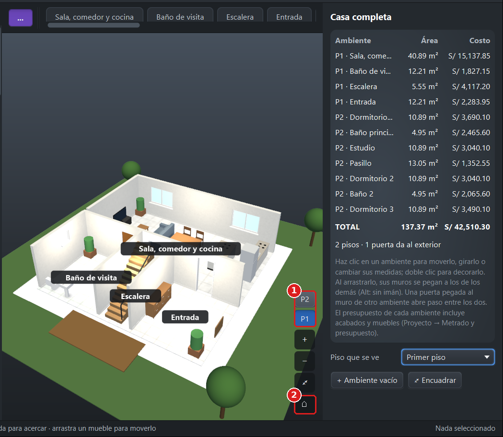

<!-- Tabla: Casa con el techo y el segundo piso ocultos -->
| N.º | Qué es | Para qué sirve |
|---|---|---|
| 1 | **P2** en gris | El segundo piso está oculto |
| 2 | Techo | Quitado: se ve el interior |

Estos botones solo cambian lo que se ve; no borran nada.

## 12. Ver y recorrer

### 12.1 Planta 2D

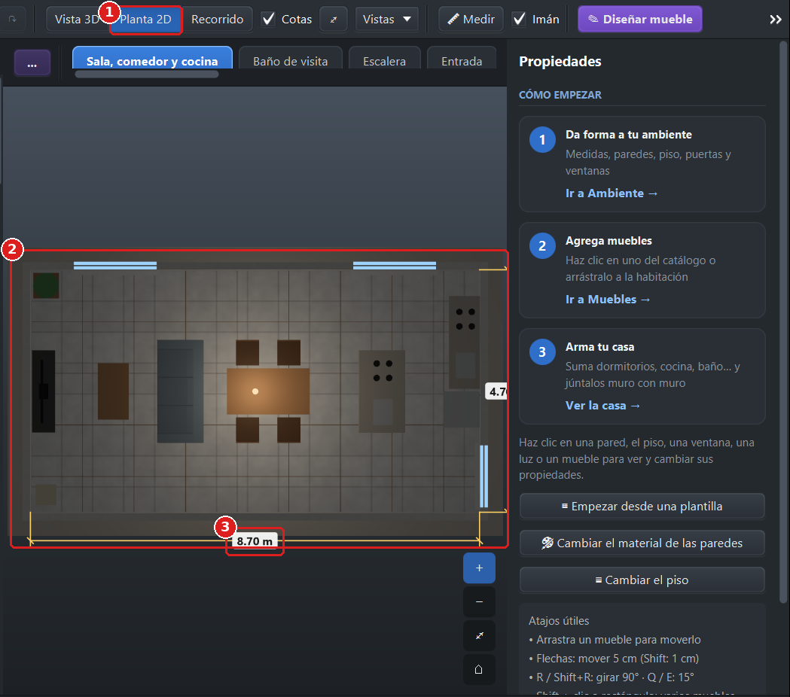

<!-- Tabla: Partes de la planta 2D -->
| N.º | Qué es | Para qué sirve |
|---|---|---|
| 1 | **Planta 2D** (`Ctrl+2`) | Ver el ambiente desde arriba, como un plano |
| 2 | Plano | Muebles, puertas y ventanas a escala |
| 3 | Cotas | Medidas en amarillo (`Ctrl+M` las oculta) |

### 12.2 Recorrido

<!-- Tabla: Partes del recorrido -->
| N.º | Qué es | Para qué sirve |
|---|---|---|
| 1 | **Recorrido** (`Ctrl+3`) | Caminar a la altura de los ojos |
| 2 | Barra de estado | Recuerda las teclas: `W`/`S` avanzar, `A`/`D` de costado, ←/→ girar, `Shift` correr |

No se atraviesan paredes ni muebles.

## 13. Diseñador de muebles

1. **Diseñar mueble** (`Ctrl+Shift+D`).
2. Escriba el **Nombre** (1) y elija de qué mueble partir (2).
3. Agregue piezas (4) y ajuste cada una en (8).
4. **Guardar en el catálogo** (9).

<!-- Tabla: Partes del diseñador de muebles -->
| N.º | Qué es | Para qué sirve |
|---|---|---|
| 1 | **Nombre** | Nombre en el catálogo |
| 2 | **Copia de: …** | Partir de una plantilla o copiar un mueble del catálogo |
| 3 | Vistas | Deshacer, rehacer, **Encuadrar**, **Frente**, **Lado**, **Arriba** |
| 4 | **+ Caja**, **+ Cilindro**, **+ Esfera**, **+ Barra** | Agregar piezas |
| 5 | **Piezas** | Clic para elegir la pieza a editar |
| 6 | **Duplicar**, **Espejo**, **Eliminar** | Copiar, reflejar o borrar la pieza |
| 7 | Medidas | Tamaño total del mueble en cm |
| 8 | **Pieza** / **Mueble** | Forma, medidas (cm), color y acabado |
| 9 | **Guardar en el catálogo** | Guardarlo en *Mis diseños* (**Cancelar** sale sin guardar) |

## 14. Presupuesto e informe PDF

1. **Presupuesto** (`Ctrl+P`).
2. Doble clic en un precio (3) para cambiarlo.
3. **Informe PDF…** (7) o **Exportar CSV…** (5).

<!-- Tabla: Partes de la ventana de presupuesto -->
| N.º | Qué es | Para qué sirve |
|---|---|---|
| 1 | Resumen | m² de piso y paredes, aberturas y perímetro |
| 2 | Tabla | Una fila por material o mueble, con cantidad y subtotal |
| 3 | **P. unitario** | Doble clic para poner el precio de su ferretería |
| 4 | **Precios referenciales** | Volver a los precios originales |
| 5 | **Exportar CSV…** | Abrir el presupuesto en Excel |
| 6 | **Total** | Suma en soles |
| 7 | **Informe PDF…** | Informe con planta, vista 3D, muebles y presupuesto |
| 8 | **Cerrar** | Volver |

Pintura: galones para 2 manos. Pisos: m² con 10 % de desperdicio. Precios referenciales (Lima, 2026),
sin mano de obra (anexo B).

## 15. Guardar y abrir

### 15.1 Menú Archivo

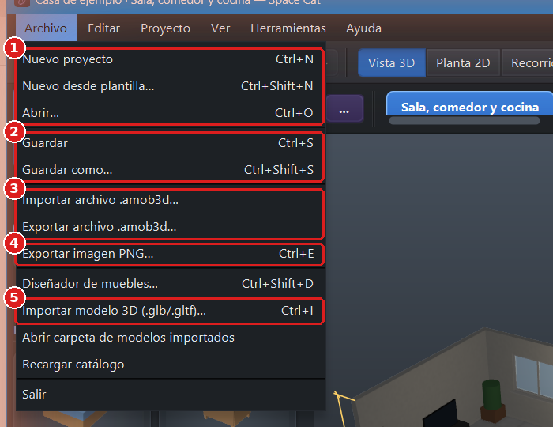

<!-- Tabla: Opciones del menú Archivo -->
| N.º | Opción | Para qué sirve |
|---|---|---|
| 1 | **Nuevo proyecto**, **Nuevo desde plantilla…**, **Abrir…** | Empezar o continuar un proyecto |
| 2 | **Guardar**, **Guardar como…** | Guardar en la computadora |
| 3 | **Importar** / **Exportar archivo .amob3d…** | Llevar el proyecto a otra computadora |
| 4 | **Exportar imagen PNG…** | Guardar una imagen de la vista |
| 5 | **Importar modelo 3D (.glb/.gltf)…** | Agregar un mueble descargado de internet |

### 15.2 Guardar

`Ctrl+S`. La primera vez pide un nombre:

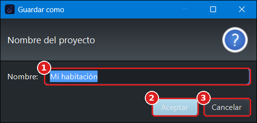

<!-- Tabla: Ventana Guardar como -->
| N.º | Qué es | Para qué sirve |
|---|---|---|
| 1 | **Nombre** | Nombre del proyecto (no se repite) |
| 2 | **Aceptar** | Guardar |
| 3 | **Cancelar** | Salir sin guardar |

### 15.3 Abrir

`Ctrl+O`.

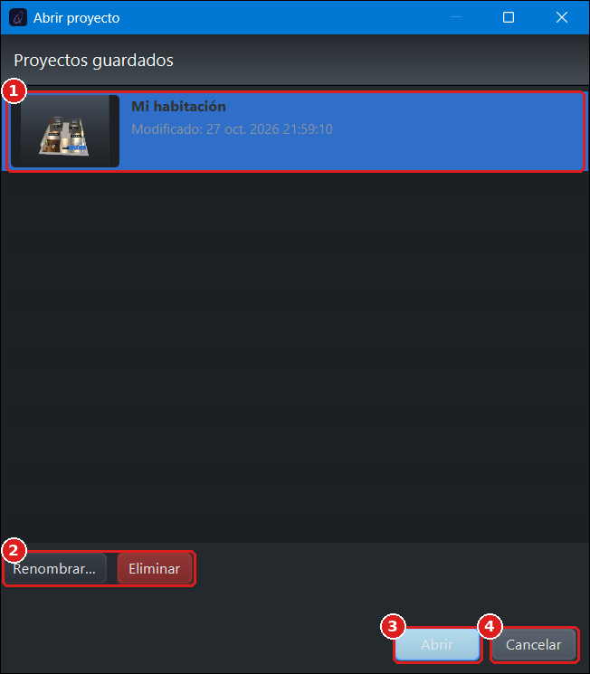

<!-- Tabla: Ventana Abrir proyecto -->
| N.º | Qué es | Para qué sirve |
|---|---|---|
| 1 | Proyecto | Miniatura, nombre y fecha; clic para elegirlo |
| 2 | **Renombrar…** / **Eliminar** | Cambiar el nombre o borrarlo (pide confirmación) |
| 3 | **Abrir** | Abrir el proyecto elegido |
| 4 | **Cancelar** | Cerrar la ventana |

### 15.4 Nuevo desde plantilla

`Ctrl+Shift+N`.

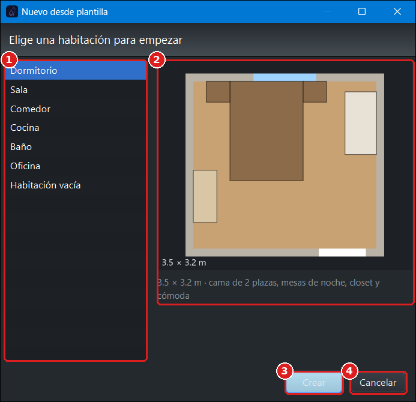

<!-- Tabla: Ventana Nuevo desde plantilla -->
| N.º | Qué es | Para qué sirve |
|---|---|---|
| 1 | Plantillas | Dormitorio, sala, comedor, cocina, baño, oficina o vacía |
| 2 | Vista previa | Plano, medidas y muebles incluidos |
| 3 | **Crear** | Abrir la plantilla elegida |
| 4 | **Cancelar** | Cerrar sin crear |

**Autoguardado:** con cambios sin guardar, la aplicación hace una copia cada minuto. Si se cierra de
golpe, al volver a abrirla ofrece **recuperar** el trabajo.

## 16. Tutoriales

### 16.1 Amoblar un dormitorio de 3,5 × 3 m

1. `Ctrl+N`.
2. **Ambiente**: Ancho `3.5`, Largo `3`, Alto `2.5` → **Aplicar medidas** (figura de la sección 7).
3. **+ Puerta → Puerta**; en propiedades, pared **Sur**.
4. **+ Ventana**; pared **Norte**.
5. **Muebles → Dormitorio**: clic en **Cama**, **Mesa de noche** (dos veces) y **Closet**.
6. Arrastre la cama a la pared norte; las mesas a sus lados.
7. Gire el closet con `R` y llévelo a una pared libre.
8. **Norte → Papel tapiz** y un color.
9. `Ctrl+3` para recorrerlo.
10. `Ctrl+S` → *Mi dormitorio*.

### 16.2 Casa de dos pisos

1. **Habitación vacía** y escriba las medidas de la sala.
2. **+ Ambiente → desde una plantilla → Dormitorio**.
3. `Ctrl+4`, seleccione el dormitorio y cambie **Piso** a *Segundo piso*.
4. Arrástrelo encima de la sala.
5. En la sala, agregue una **Escalera en L** (categoría **Escaleras**).
6. `Ctrl+1` y use **P1**, **P2** y techo para verla.

### 16.3 Presupuesto de pintura

1. Clic en una pared → **Pintura mate** → **Aplicar a todas**.
2. `Ctrl+P`: la fila de pintura muestra m² y galones.
3. Doble clic en **P. unitario** y escriba el precio real.
4. **Exportar CSV…** o **Informe PDF…**.

## 17. Mensajes del sistema

Los errores aparecen en **rojo** sobre la vista y quedan escritos en la barra de estado.

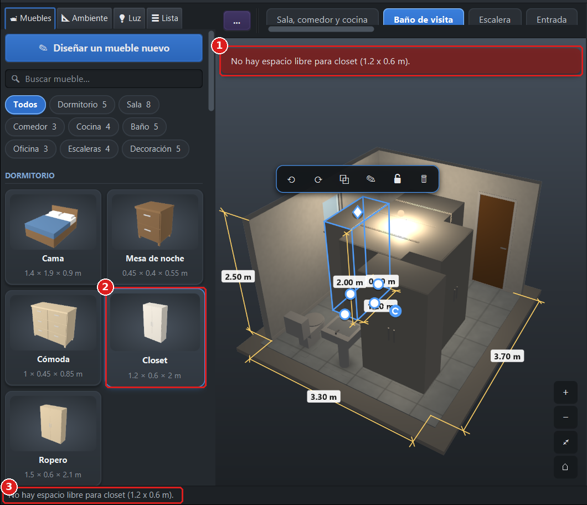

<!-- Tabla: Partes del aviso de error -->
| N.º | Qué es | Para qué sirve |
|---|---|---|
| 1 | Aviso rojo | Explica por qué no se hizo la acción |
| 2 | Mueble pedido | El closet que ya no entraba |
| 3 | Barra de estado | El mismo aviso, para leerlo con calma |

Cuando hay que decidir, aparece una ventana. Por ejemplo, al cerrar con cambios sin guardar:

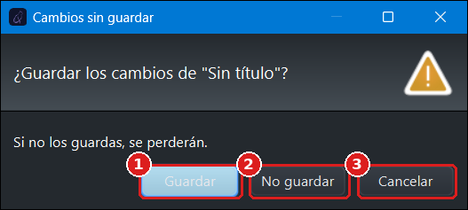

<!-- Tabla: Ventana Cambios sin guardar -->
| N.º | Botón | Qué hace |
|---|---|---|
| 1 | **Guardar** | Guarda y continúa |
| 2 | **No guardar** | Continúa y pierde los cambios |
| 3 | **Cancelar** | Vuelve al proyecto |

<!-- Tabla: Mensajes del sistema y qué hacer -->
| Mensaje | Qué hacer |
|---|---|
| *No hay espacio libre para …* | Mover o achicar otros muebles, o agrandar el ambiente |
| *Choca con …* / *Bloquea el paso de …* | Moverlo a otro lugar o soltar el imán con `Alt` |
| *No cabe dentro de la habitación* | Acercarlo al centro o achicarlo |
| *Es más alto (…) que la habitación* | Bajar el mueble o subir el alto del ambiente |
| *… ya no cabía y se eliminó* | `Ctrl+Z` si fue un error |
| *… está bloqueado* | Pulsar `L` |
| *Ya existe un proyecto llamado …* | Usar otro nombre |
| *¿Quieres recuperarlos?* | **Recuperar** el trabajo de la última vez |
| *El archivo no es un modelo glTF válido* | Descargar otro modelo |
| *Agrega una puerta principal…* | Poner una puerta en una pared exterior |
| *No se pudo exportar* | Cerrar el archivo en el otro programa o elegir otra carpeta |
| *Algo salió mal* | Guardar y enviar el registro al soporte (sección 19) |

## 18. Atajos de teclado

`F1` muestra todos los atajos; **Aceptar** cierra la ventana.

<!-- Tabla: Atajos más usados -->
| Tecla | Acción |
|---|---|
| `Ctrl+N` / `Ctrl+O` / `Ctrl+S` | Nuevo / Abrir / Guardar |
| `Ctrl+Z` / `Ctrl+Y` | Deshacer / Rehacer |
| `R` · `Q` / `E` | Girar 90° · 15° |
| `Supr` / `Ctrl+D` | Eliminar / Duplicar |
| `Ctrl+A` | Seleccionar todos |
| `L` / `G` | Bloquear / Imán |
| `Ctrl+1` / `2` / `3` / `4` | 3D / Planta / Recorrido / Casa completa |
| `N` | Modo noche |
| `Ctrl+P` / `Ctrl+Shift+P` | Presupuesto / Informe PDF |
| `F11` | Pantalla completa |

## 19. Solución de problemas

<!-- Tabla: Problemas frecuentes -->
| Problema | Solución |
|---|---|
| Un mueble no se mueve | Está bloqueado (`L`) o chocaría con algo |
| El mueble no queda donde se suelta | Mantener `Alt` o desactivar el imán (`G`) |
| No se ve el techo | Solo aparece en el **Recorrido** o con el botón de techo en **Casa completa** |
| La vista 3D se ve negra o lenta | Actualizar el controlador de video |
| *No se pudo abrir la base de datos* | Cerrar la otra ventana de Space Cat |
| Se cortó la luz | Abrir la aplicación y pulsar **Recuperar** |
| *Algo salió mal* | *Ayuda → Abrir registro de errores* y enviar `amoblador3d-0.log` por WhatsApp al 919 192 008 |

¿Dónde están los datos? *Ayuda → Acerca de Space Cat* lo muestra:

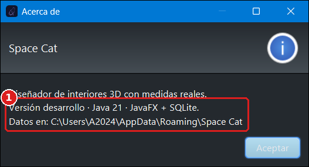

<!-- Tabla: Ventana Acerca de -->
| N.º | Qué es | Para qué sirve |
|---|---|---|
| 1 | Versión y **Datos en** | Versión instalada y carpeta de los proyectos (para copias de seguridad) |

## 20. Consejos

- **Mida antes de dibujar**: ancho, largo, alto y posición de puertas y ventanas.
- **Primero puertas y ventanas**, luego muebles grandes, al final los pequeños.
- **Bloquee** (`L`) lo que ya está bien.
- **Recorra** (`Ctrl+3`) para ver si se puede pasar.
- **Guarde seguido** (`Ctrl+S`) y exporte una copia `.amob3d`.
- **Cambie los precios** por los de su ferretería antes de comprar.

## 21. Glosario

<!-- Tabla: Glosario -->
| Término | Significado |
|---|---|
| Alféizar | Altura del piso al borde inferior de la ventana |
| Ambiente | Cada habitación |
| Cota | Medida dibujada en el plano |
| Imán | Ayuda que pega el mueble a paredes y muebles |
| Machón | Columna pegada a un muro |
| Metrado | Cálculo de m² y metros de material |
| Planta | Vista desde arriba |
| Vano | Abertura sin puerta |
| Zócalo | Franja al pie de la pared |

## Anexo A. Catálogo de muebles paramétricos

Medidas iniciales; se cambian en **Medidas** dentro del rango indicado.

<!-- Tabla: Muebles paramétricos con sus medidas iniciales y rangos -->
| Categoría | Mueble | Medidas iniciales, ancho × prof. × alto (m) | Rango de ancho (m) | Rango de prof. (m) | Rango de alto (m) | Color secundario |
|---|---|---|---|---|---|---|
| Dormitorio | Cama | 1,40 × 1,90 × 0,90 | 0,8–2,2 | 1,8–2,3 | 0,5–1,4 | Frazada |
| Dormitorio | Mesa de noche | 0,45 × 0,40 × 0,55 | 0,3–0,7 | 0,3–0,6 | 0,4–0,8 | Frentes de cajones |
| Dormitorio | Cómoda | 1,00 × 0,45 × 0,85 | 0,6–2,0 | 0,35–0,6 | 0,6–1,3 | Frentes de cajones |
| Dormitorio | Closet | 1,20 × 0,60 × 2,00 | 0,5–3,0 | 0,4–0,8 | 1,2–2,6 | Puertas |
| Dormitorio | Ropero | 1,50 × 0,60 × 2,10 | 0,8–3 | 0,5–0,75 | 1,8–2,5 | Puertas |
| Sala | Sofá | 2,00 × 0,90 × 0,85 | 1,2–3,2 | 0,7–1,1 | 0,7–1,1 | Cojines |
| Sala | Mueble de TV | 1,60 × 0,45 × 1,25 | 1,0–2,6 | 0,35–0,6 | 0,9–1,6 | Puertas |
| Sala | Librero | 0,80 × 0,30 × 1,80 | 0,4–2,4 | 0,2–0,5 | 0,6–2,4 | Fondo |
| Sala | Mesa de centro | 1,10 × 0,60 × 0,42 | 0,6–1,6 | 0,4–0,9 | 0,3–0,55 | Tapa |
| Sala | Sillón | 0,90 × 0,90 × 0,85 | 0,7–1,2 | 0,7–1,0 | 0,7–1,0 | Cojines |
| Sala | Lámpara de pie | 0,40 × 0,40 × 1,60 | 0,3–0,6 | 0,3–0,6 | 1,2–1,9 | Pantalla |
| Sala | Televisor | 1,20 × 0,08 × 0,70 | 0,6–2,0 | 0,05–0,12 | 0,4–1,2 | Pantalla |
| Comedor | Mesa | 1,20 × 0,80 × 0,75 | 0,4–3,0 | 0,4–1,5 | 0,4–1,1 | Patas |
| Comedor | Silla | 0,45 × 0,50 × 0,90 | 0,35–0,7 | 0,35–0,7 | 0,7–1,2 | Asiento |
| Comedor | Aparador | 1,60 × 0,45 × 0,85 | 0,9–2,4 | 0,35–0,6 | 0,7–1,1 | Puertas |
| Cocina | Mueble de cocina | 1,80 × 0,60 × 0,90 | 0,6–4,0 | 0,5–0,7 | 0,8–1,0 | Encimera |
| Cocina | Refrigeradora | 0,70 × 0,70 × 1,80 | 0,5–1,0 | 0,55–0,8 | 1,2–2,1 | Tiradores |
| Cocina | Isla de cocina | 1,60 × 0,90 × 0,90 | 1,0–2,6 | 0,6–1,1 | 0,85–1,0 | Encimera |
| Cocina | Alacena | 1,20 × 0,35 × 0,70 | 0,6–2,4 | 0,3–0,5 | 0,5–0,9 | Puertas |
| Baño | Inodoro | 0,40 × 0,70 × 0,75 | 0,35–0,5 | 0,6–0,8 | 0,65–0,85 | Asiento |
| Baño | Lavatorio | 0,55 × 0,45 × 0,85 | 0,4–0,8 | 0,35–0,6 | 0,75–0,95 | Grifería |
| Baño | Tina | 1,60 × 0,75 × 0,55 | 1,2–1,9 | 0,65–0,85 | 0,45–0,65 | Interior |
| Baño | Ducha | 0,90 × 0,90 × 2,10 | 0,7–1,4 | 0,7–1,4 | 1,9–2,3 | Mampara |
| Baño | Espejo | 0,80 × 0,05 × 0,60 | 0,4–1,4 | 0,03–0,1 | 0,4–1,0 | Marco |
| Oficina | Escritorio | 1,20 × 0,60 × 0,75 | 0,8–2,4 | 0,45–0,9 | 0,65–0,9 | Frentes de cajones |
| Oficina | Silla de oficina | 0,60 × 0,60 × 1,10 | 0,5–0,75 | 0,5–0,75 | 0,9–1,3 | Asiento |
| Oficina | Estante | 0,90 × 0,30 × 1,80 | 0,4–2,4 | 0,2–0,5 | 0,6–2,4 | Fondo |
| Escaleras | Escalera recta | 0,90 × 3,60 × 2,50 | 0,6–2,0 | 1,2–7,0 | 0,4–6,0 | Pasamanos |
| Escaleras | Escalera en L | 2,00 × 2,60 × 2,50 | 1,4–4,0 | 1,4–5,0 | 0,8–6,0 | Pasamanos |
| Escaleras | Escalera de caracol | 1,60 × 1,60 × 2,50 | 1,1–2,6 | 1,1–2,6 | 0,8–6,0 | Peldaños |
| Escaleras | Baranda | 1,50 × 0,06 × 0,90 | 0,3–8,0 | 0,04–0,2 | 0,6–1,2 | Pasamanos |
| Decoración | Planta | 0,50 × 0,50 × 1,10 | 0,3–1,0 | 0,3–1,0 | 0,5–2,0 | Follaje |
| Decoración | Maceta | 0,40 × 0,40 × 0,60 | 0,25–0,8 | 0,25–0,8 | 0,3–1,2 | Follaje |
| Decoración | Alfombra | 2,00 × 1,40 × 0,02 | 0,8–3,5 | 0,6–2,5 | 0,01–0,05 | Borde |
| Decoración | Cuadro | 0,80 × 0,04 × 0,60 | 0,3–1,6 | 0,03–0,08 | 0,3–1,2 | Marco |
| Decoración | Cortina | 1,50 × 0,06 × 2,00 | 0,6–3,0 | 0,04–0,12 | 1,2–2,6 | Tela |

Las escaleras ajustan su alto al del ambiente.

## Anexo B. Materiales y precios de referencia

<!-- Tabla: Materiales de acabado, superficies permitidas, unidad de compra y precio de referencia -->
| Material | Paredes | Piso | Techo | Se compra en | Precio de referencia (S/) |
|---|---|---|---|---|---|
| Pintura mate | Sí | No | Sí | Galones (2 manos, 35 m² por galón) | 65,00 por galón |
| Pintura satinada | Sí | No | Sí | Galones (2 manos, 35 m² por galón) | 85,00 por galón |
| Papel tapiz | Sí | No | No | Rollos de 5,3 m², +10 % para empalmes | 45,00 por rollo |
| Ladrillo | Sí | No | No | m², +10 % por cortes | 55,00 por m² |
| Piedra | Sí | Sí | No | m², +10 % por cortes | 70,00 por m² |
| Concreto | Sí | Sí | Sí | m², +10 % por cortes | 60,00 por m² |
| Madera | Sí | Sí | Sí | m², +10 % por cortes | 90,00 por m² |
| Cerámico | Sí | Sí | No | m², +10 % por cortes | 35,00 por m² |
| Mármol | Sí | Sí | No | m², +10 % por cortes | 180,00 por m² |
| Porcelanato | No | Sí | No | m², +10 % por cortes | 60,00 por m² |
| Alfombra | No | Sí | No | m², +10 % por cortes | 40,00 por m² |
| Zócalo | — | — | — | Metros lineales, sin el ancho de las puertas | 12,00 por m |

<!-- Tabla: Precios de referencia de los muebles paramétricos -->
| Mueble | Precio (S/) | Mueble | Precio (S/) |
|---|---|---|---|
| Cama | 900,00 | Mueble de cocina | 1 800,00 |
| Mesa de noche | 180,00 | Refrigeradora | 2 200,00 |
| Cómoda | 600,00 | Inodoro | 350,00 |
| Closet | 1 200,00 | Lavatorio | 250,00 |
| Sofá | 1 500,00 | Escritorio | 400,00 |
| Mueble de TV | 2 500,00 | Escalera recta | 3 500,00 |
| Librero | 350,00 | Escalera en L | 5 200,00 |
| Mesa | 450,00 | Escalera de caracol | 4 800,00 |
| Silla | 120,00 | Baranda | 300,00 |

Los precios se cambian en la ventana de presupuesto (sección 14).

## Anexo C. Medidas iniciales de las aberturas

<!-- Tabla: Medidas iniciales de cada tipo de abertura -->
| Tipo | Ancho (m) | Alto (m) | Alféizar (m) |
|---|---|---|---|
| Ventana | 1,20 | 1,00 | 0,90 |
| Puerta normal | 0,90 | 2,10 | 0 |
| Puerta principal | 1,00 | 2,20 | 0 |
| Puerta doble | 1,40 | 2,20 | 0 |
| Puerta corrediza | 1,80 | 2,10 | 0 |
| Portón de cochera | 2,60 | 2,20 | 0 |
| Vano sin puerta | 0,90 | 2,10 | 0 |
