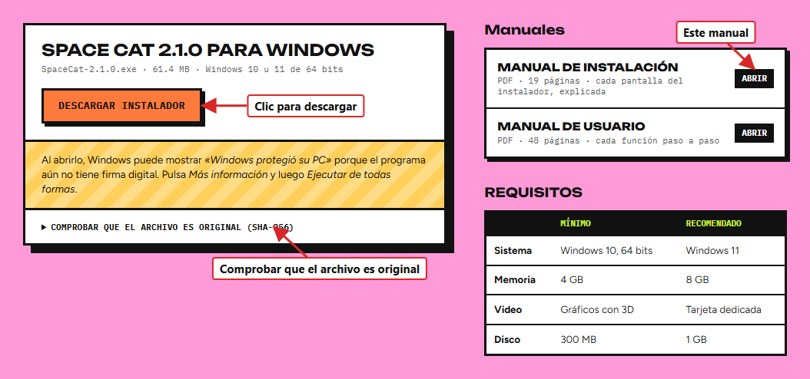
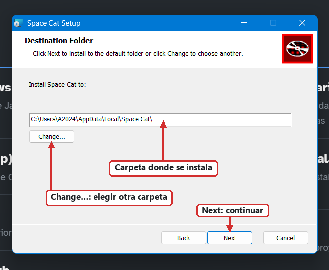
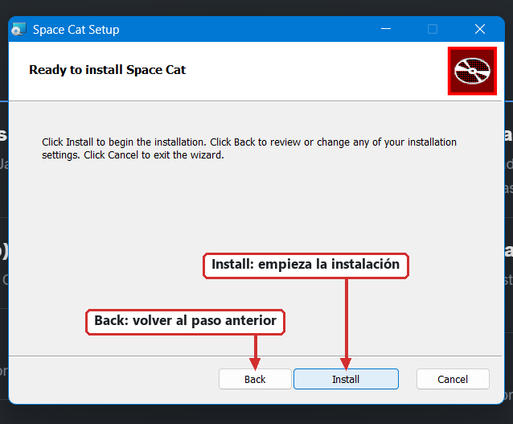
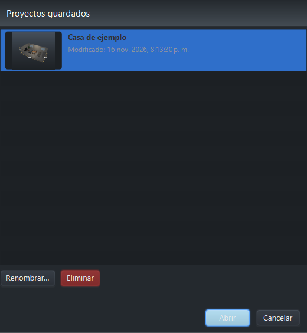

# Manual de instalación

## 1. Introducción

### 1.1 Propósito

Este manual explica, paso a paso y con las pantallas reales, cómo instalar Space Cat 2.1.0 en una
computadora con Windows usando su instalador, el único archivo que hay que descargar. También indica
cómo comprobar que funciona, dónde se guardan sus proyectos, cómo actualizarla, cómo desinstalarla y
qué hacer ante los avisos más comunes. El uso de la aplicación se explica en el manual de usuario.

El instalador trae todo lo necesario, incluido Java: no hay que instalar ningún otro programa ni se
necesitan permisos de administrador.

### 1.2 Convenciones

<!-- Tabla: Convenciones tipográficas del manual -->
| Convención | Significado | Ejemplo |
|---|---|---|
| **Negrita** | Botón, opción o campo de la pantalla, escrito tal como aparece | Pulse **Next** |
| *Menú → Opción* | Ruta dentro de un menú | *Ayuda → Acerca de Space Cat* |
| `texto en recuadro` | Nombre de un archivo o de una carpeta | `SpaceCat-2.1.0.exe` |
| «texto entre comillas» | Mensaje que muestra Windows o la aplicación | «Windows protegió su PC» |

**Importante:** el instalador de Space Cat muestra sus ventanas **en inglés**. En
este manual los botones se escriben tal como aparecen (**Next**, **Install**, **Finish**) y se indica
qué significan.

### 1.3 Comprobar que la descarga es original (opcional)

Cada archivo publicado tiene una huella **SHA-256**: un código que cambia por completo si el archivo
se modifica o se descarga incompleto. Para comprobarla, abra **PowerShell** (clic derecho en el botón Inicio → **Terminal**) y
escriba, pulsando `Enter` después de cada línea:

```powershell
cd $HOME\Downloads
Get-FileHash .\SpaceCat-2.1.0.exe
```

El valor de la columna **Hash** debe ser exactamente el de la tabla siguiente:

<!-- Tabla: Huellas SHA-256 de los archivos de la versión 2.1.0 -->
| Archivo | SHA-256 |
|---|---|
| `SpaceCat-2.1.0.exe` | `F7461B795E7BA5DAA7421CC623B504358DE03255DCED201D0F5542107677CA03` |

Si no coincide, borre el archivo y vuelva a descargarlo.

## 2. Requisitos del equipo

<!-- Tabla: Requisitos mínimos y recomendados del equipo -->
| Elemento | Mínimo | Recomendado |
|---|---|---|
| Sistema operativo | Windows 10 de 64 bits | Windows 11 |
| Procesador | Doble núcleo de 2 GHz | Cuatro núcleos |
| Memoria RAM | 4 GB | 8 GB |
| Video | Aceleración 3D (sirve la tarjeta integrada) | Tarjeta dedicada |
| Espacio en disco | 300 MB libres | 1 GB (si se importan muchos modelos 3D) |
| Pantalla | 1280 × 720 | 1920 × 1080 |

Para saber si la computadora es de 64 bits: *Configuración → Sistema → Información* y revisar
**Tipo de sistema**; debe decir «Sistema operativo de 64 bits».

## 3. Instalar Space Cat

### 3.1 Descargar el instalador

1. Abra la página web de Space Cat (`alex123floresc-sketch.github.io/Space_Cat`) y pulse
   **Descargar** en la barra superior (o **Descargar para Windows** en la portada). La página baja a
   la sección **Descargar**.
2. Pulse **Descargar instalador**. Se descarga `SpaceCat-2.1.0.exe`, de **61.4 MB**.
3. Arriba a la derecha del navegador aparece el botón de **descargas** (una flecha hacia abajo). Al
   pulsarlo se abre el **Historial de descargas recientes**, con la línea
   «SpaceCat-2.1.0.exe · 61.4 MB · Listo» cuando la descarga terminó.
4. Si el navegador avisa que el archivo «no se descarga normalmente», pulse **Conservar** (en
   Microsoft Edge: **…** → **Conservar** → **Mostrar más** → **Conservar de todos modos**).



<!-- Tabla: Elementos señalados al descargar el instalador -->
| Elemento señalado | Función | Para qué sirve |
|---|---|---|
| **Clic para descargar** | Botón **Descargar instalador** | Descarga `SpaceCat-2.1.0.exe`, el único archivo necesario: trae la aplicación y su propio Java |
| **Comprobar que el archivo es original** | Apartado desplegable *Comprobar que el archivo es original (SHA-256)* | Muestra la huella SHA-256 del instalador para confirmar que el archivo no fue alterado (apartado 1.3) |
| **Este manual** | Botón **Abrir** del *Manual de instalación* | Abre este mismo manual en PDF desde la página web |

El archivo también queda en la carpeta **Descargas** (`C:\Users\<su usuario>\Downloads`).

### 3.2 Abrir el instalador y la advertencia de Windows (SmartScreen)

1. Haga clic en la línea **SpaceCat-2.1.0.exe** del historial de descargas, o doble clic en el
   archivo dentro de la carpeta **Descargas**.
2. La primera vez, Windows muestra una ventana azul titulada **«Windows protegió su PC»**, con el
   texto «SmartScreen de Microsoft Defender impidió el inicio de una aplicación desconocida».
   Aparece porque el instalador no tiene firma digital, no porque tenga un problema.
3. Si solo se ve el botón **No ejecutar**, haga clic en **Más información** (debajo del texto): se
   muestran «Aplicación: SpaceCat-2.1.0.exe», «Editor: Editor desconocido» y el botón
   **Ejecutar de todas formas**.
4. Compruebe que el nombre sea `SpaceCat-2.1.0.exe` y pulse **Ejecutar de todas formas**.


<!-- Tabla: Elementos señalados en la advertencia de Windows -->
| Elemento señalado | Función | Para qué sirve |
|---|---|---|
| **Nombre del archivo** | Muestra qué programa se va a abrir | Comprobar que es `SpaceCat-2.1.0.exe` y no otro archivo |
| **Ejecutar de todas formas** | Abre el instalador a pesar del aviso | Continuar con la instalación |
| **No ejecutar: cancela** | Cierra el aviso sin abrir nada | Salir si el nombre no coincide o si se abrió por error |

El instalador **no pide permisos de administrador**: se instala solo para el usuario actual.

### 3.3 Instalar paso a paso

El asistente de instalación está **en inglés** y tiene cinco pantallas. En cualquiera de ellas,
**Back** vuelve al paso anterior y **Cancel** cancela la instalación sin dejar archivos.

**Paso 1. Bienvenida.** La ventana «Space Cat Setup» muestra «Welcome to the Space Cat Setup Wizard»
(Bienvenido al asistente de instalación de Space Cat). Pulse **Next**.


<!-- Tabla: Elementos señalados en la bienvenida del asistente -->
| Elemento señalado | Función | Para qué sirve |
|---|---|---|
| **Next: continuar** | Botón *Siguiente* | Pasar a elegir la carpeta de instalación |
| **Cancel: salir sin instalar** | Botón *Cancelar* | Cerrar el asistente sin instalar nada |

**Paso 2. Carpeta de destino.** «Destination Folder» indica dónde se instalará el programa, por
omisión `C:\Users\<su usuario>\AppData\Local\Space Cat\`. Se recomienda dejarla así y pulsar
**Next**. Para usar otra carpeta, pulse **Change…**, elíjala y pulse **OK**.



<!-- Tabla: Elementos señalados en la pantalla de carpeta de destino -->
| Elemento señalado | Función | Para qué sirve |
|---|---|---|
| **Carpeta donde se instala** | Campo con la ruta de instalación («Install Space Cat to») | Ver dónde quedará el programa |
| **Change…: elegir otra carpeta** | Botón *Cambiar* | Instalar en otra carpeta o en otra unidad con más espacio |
| **Next: continuar** | Botón *Siguiente* | Aceptar la carpeta y seguir |

**Paso 3. Listo para instalar.** «Ready to install Space Cat» confirma que todo está preparado.
Pulse **Install**.



<!-- Tabla: Elementos señalados en la pantalla Ready to install -->
| Elemento señalado | Función | Para qué sirve |
|---|---|---|
| **Install: empieza la instalación** | Botón *Instalar* | Copiar el programa a la carpeta elegida y crear los accesos directos |
| **Back: volver al paso anterior** | Botón *Atrás* | Revisar o cambiar la carpeta antes de instalar |

**Paso 4. Instalando.** «Installing Space Cat» muestra la barra de progreso (**Status**). Tarda menos
de un minuto; no cierre la ventana.


<!-- Tabla: Elementos señalados mientras se instala -->
| Elemento señalado | Función | Para qué sirve |
|---|---|---|
| **Barra de progreso (Status)** | Avanza mientras se copian los archivos | Saber cuánto falta |
| **Cancel: detener la instalación** | Botón *Cancelar* | Detener y deshacer la instalación |

**Paso 5. Terminado.** Aparece «Completed the Space Cat Setup Wizard» (instalación terminada). Pulse
**Finish** para cerrar el asistente.

**Qué se instala y dónde:**

<!-- Tabla: Elementos que crea el instalador -->
| Elemento | Ubicación |
|---|---|
| Programa (incluye su propio Java) | La carpeta elegida en el paso 2; por omisión, `%LOCALAPPDATA%\Space Cat` |
| Acceso directo en el menú Inicio | Carpeta **Space Cat** del menú Inicio |
| Acceso directo en el escritorio | **Space Cat** |
| Entrada para desinstalar | *Configuración → Aplicaciones → Aplicaciones instaladas* |

Los proyectos del usuario no se guardan en la carpeta del programa, sino en `%APPDATA%\Space Cat`
(sección 5).

### 3.4 Abrir la aplicación por primera vez

1. Abra **Space Cat** desde el menú Inicio (escriba «Space Cat» después de pulsar la tecla de
   Windows) o con doble clic en el acceso directo del escritorio.
2. En unos segundos aparece la pantalla de bienvenida «¿Qué quieres hacer hoy?». La primera vez la
   aplicación crea su carpeta de datos y su base de datos; no hay que configurar nada.
3. Para comprobar que todo funciona, siga la sección 4.


## 4. Verificar la instalación

<!-- Tabla: Pasos para comprobar que la instalación funciona -->
| Paso | Qué hacer | Resultado esperado |
|---|---|---|
| 1 | Abrir Space Cat | Aparece la pantalla *«¿Qué quieres hacer hoy?»* |
| 2 | Elegir **Casa de ejemplo** | La casa se ve en 3D y gira al arrastrar con el ratón |
| 3 | *Ayuda → Acerca de Space Cat* | Muestra la versión 2.1.0 y la carpeta de datos |
| 4 | Guardar con `Ctrl+S`, cerrar y volver a abrir | El proyecto aparece en *Archivo → Abrir…* |



Si algún paso no da el resultado esperado, vea la sección 8.

## 5. Datos del usuario

La base de datos se crea sola la primera vez y se actualiza sola en cada versión nueva: no hay que
configurar nada. La aplicación guarda los datos en la carpeta `%APPDATA%\Space Cat` (para abrirla,
escriba esa ruta en la barra de direcciones del Explorador de Windows).

<!-- Tabla: Ubicación de los datos del usuario -->
| Contenido | Ubicación |
|---|---|
| Proyectos, diseños de muebles y precios | `%APPDATA%\Space Cat\amoblador3d.db` |
| Modelos 3D importados | `%APPDATA%\Space Cat\modelos\` |
| Copia automática del trabajo sin guardar | `%APPDATA%\Space Cat\recuperacion.json` |
| Registro de errores | `%APPDATA%\Space Cat\logs\` |

- **Copia de seguridad:** con la aplicación cerrada, copie la carpeta `%APPDATA%\Space Cat` completa.
- **Pasar a otra computadora:** copie esa carpeta al mismo lugar en la otra computadora, o exporte
  cada proyecto como `.amob3d` (*Archivo → Exportar*).

## 6. Actualizar a una versión nueva

1. Descargue la versión nueva como en la sección 3.1.
2. Instálela encima de la anterior.
3. Abra la aplicación: la base de datos se actualiza sola al nuevo formato, sin perder proyectos.

**Si antes tenía Amoblador3D 2.0.0.** Space Cat 2.1.0 es la misma aplicación con otro nombre. La
primera vez que se abre, si existe la carpeta de datos anterior `%APPDATA%\Amoblador3D` y todavía no
existe `%APPDATA%\Space Cat`, copia allí los proyectos, diseños, precios y modelos importados, una
sola vez y sin borrar la carpeta anterior. Los archivos `.amob3d` guardados con Amoblador3D se abren
igual en Space Cat. Cuando compruebe que sus proyectos aparecen en *Archivo → Abrir…*, puede
desinstalar **Amoblador3D** desde *Configuración → Aplicaciones* (sección 7): ambas aplicaciones
pueden convivir mientras tanto porque se instalan en carpetas distintas.

Una base de datos creada por una versión más nueva **no** se puede abrir con una más antigua; la
aplicación lo avisa.

## 7. Desinstalar

1. Abra *Configuración → Aplicaciones → Aplicaciones instaladas*.
2. Busque **Space Cat**, pulse **…** a la derecha y elija **Desinstalar**; confirme con
   **Desinstalar**.

También se puede desde *Panel de control → Programas → Desinstalar un programa*.

**Proyectos del usuario:** desinstalar no borra los proyectos guardados. Para
eliminarlos también, borre la carpeta `%APPDATA%\Space Cat`. Esta acción no se puede deshacer:
haga antes una copia de seguridad si la necesita (sección 5).

## 8. Posibles advertencias o errores comunes

<!-- Tabla: Advertencias y errores comunes al instalar o ejecutar, y su solución -->
| Problema | Causa | Solución |
|---|---|---|
| *«Windows protegió su PC»* | El instalador no tiene firma digital | **Más información → Ejecutar de todas formas** (sección 3.2) |
| El navegador bloquea la descarga | El archivo se descarga poco | **Conservar** (en Edge: **…** → **Conservar** → **Conservar de todos modos**) |
| El instalador dice que no hay espacio | Menos de 300 MB libres en el disco | Liberar espacio o elegir otra unidad con **Change…** (sección 3.3) |
| La huella SHA-256 no coincide | Descarga incompleta o archivo alterado | Borrar el archivo y volver a descargarlo (sección 1.3) |
| *No se pudo abrir la base de datos* | Otra ventana de Space Cat está abierta, o el archivo `.db` está abierto en otro programa | Cerrarlos y volver a abrir la aplicación |
| La vista 3D se ve negra o muy lenta | Controlador de video desactualizado | Actualizar el controlador de la tarjeta de video |
| Apareció *Algo salió mal* | Error inesperado de la aplicación | *Ayuda → Abrir registro de errores* y enviar el archivo `amoblador3d-0.log` al soporte de Space Cat por WhatsApp (919 192 008) |
