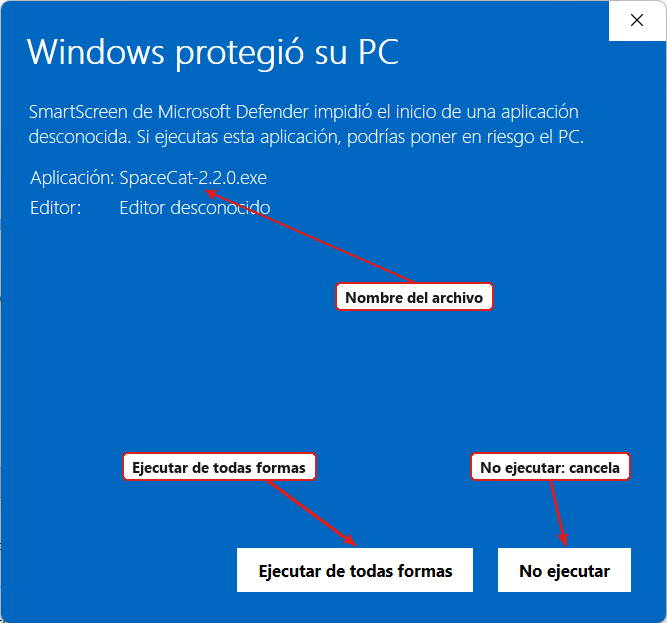
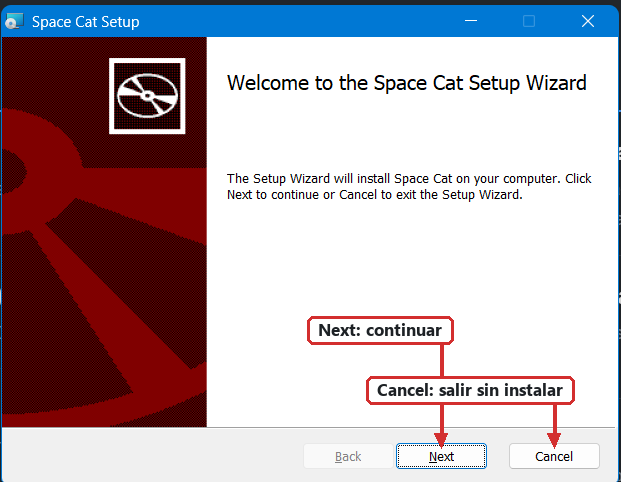
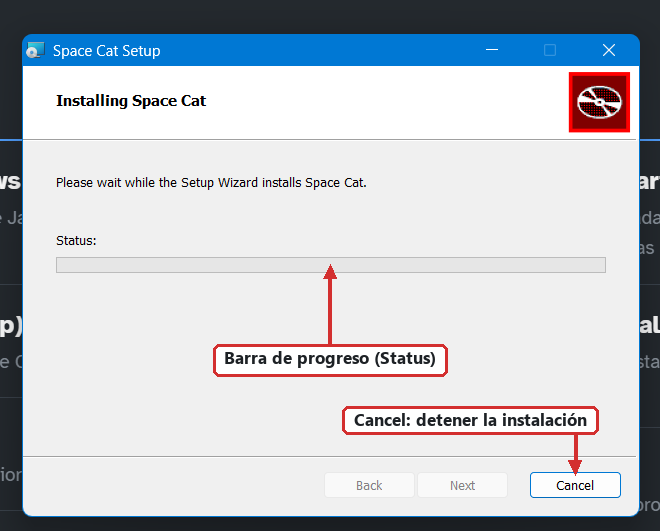
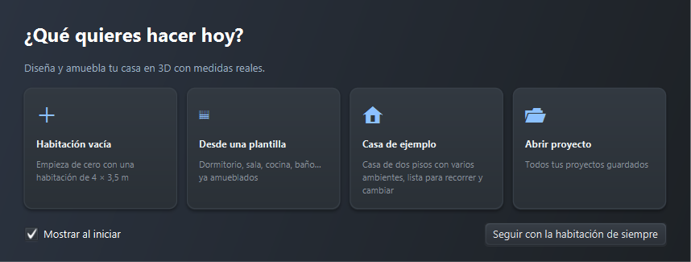

# Manual de instalación

## 1. Antes de empezar

Solo necesitas un archivo: el instalador `SpaceCat-2.2.0.exe`. Trae todo, incluido Java, y no pide
permisos de administrador. Aquí verás cómo instalarlo, comprobar que funciona, actualizarlo y
desinstalarlo. El uso de la aplicación está en el manual de usuario.

El instalador está en inglés, así que los botones aparecen tal cual: **Next**, **Install**,
**Finish**.

### 1.1 ¿Es el archivo original? (opcional)

Cada archivo tiene una huella **SHA-256** que cambia por completo si se altera o se descarga a medias.
Abre **PowerShell** (clic derecho en Inicio → **Terminal**) y escribe:

```powershell
cd $HOME\Downloads
Get-FileHash .\SpaceCat-2.2.0.exe
```

La columna **Hash** debe decir exactamente:

<!-- Tabla: Huella SHA-256 del instalador 2.2.0 -->
| Archivo | SHA-256 |
|---|---|
| `SpaceCat-2.2.0.exe` | `D77AFA666C3326C1960AA0B8D863766136496326C92F0AE7E43FB4FA222BC36C` |

Si no coincide, bórralo y descárgalo otra vez.

## 2. Requisitos

<!-- Tabla: Requisitos del equipo -->
| Elemento | Mínimo | Recomendado |
|---|---|---|
| Sistema operativo | Windows 10 de 64 bits | Windows 11 |
| Procesador | Doble núcleo de 2 GHz | Cuatro núcleos |
| Memoria RAM | 4 GB | 8 GB |
| Video | Aceleración 3D (sirve la integrada) | Tarjeta dedicada |
| Espacio en disco | 300 MB | 1 GB |
| Pantalla | 1280 × 720 | 1920 × 1080 |

¿Tu PC es de 64 bits? Míralo en *Configuración → Sistema → Información*, en **Tipo de sistema**.

## 3. Instalar

### 3.1 Descargar

En la página de Space Cat (`alex123floresc-sketch.github.io/Space_Cat`), ve a **Descargar** y pulsa
**Descargar instalador** (61.4 MB). Ahí mismo están la huella SHA-256 y este manual.


Si el navegador dice que el archivo «no se descarga normalmente», pulsa **Conservar** (en Edge:
**…** → **Conservar** → **Mostrar más** → **Conservar de todos modos**). El archivo queda en tu
carpeta **Descargas**.

### 3.2 Aviso de Windows

Abre el archivo. Como no tiene firma digital, la primera vez Windows muestra «Windows protegió su
PC». No es un problema: pulsa **Más información**, revisa que el nombre sea `SpaceCat-2.2.0.exe` y
pulsa **Ejecutar de todas formas**.



### 3.3 Paso a paso

Son cinco pantallas. **Back** vuelve atrás y **Cancel** sale sin dejar nada instalado.

**1.** En la bienvenida, pulsa **Next**.



**2.** Te muestra dónde se instalará. Déjalo así y pulsa **Next**, o elige otra carpeta con
**Change…**


**3.** Pulsa **Install**.


**4.** Espera a que se llene la barra; tarda menos de un minuto.



**5.** Pulsa **Finish**. Tendrás **Space Cat** en el menú Inicio y en el escritorio.

### 3.4 Abrir por primera vez

Abre **Space Cat** desde Inicio o el escritorio. En unos segundos aparece «¿Qué quieres hacer hoy?».
No hay nada que configurar.



## 4. Comprobar que funciona

1. Elige **Casa de ejemplo**: debe verse en 3D y girar al arrastrarla.
2. En *Ayuda → Acerca de Space Cat* debe decir versión 2.2.0.
3. Guarda con `Ctrl+S`, cierra y vuelve a abrir: el proyecto aparece en *Archivo → Abrir…*


## 5. Dónde están tus proyectos

Todo se guarda solo en `%APPDATA%\Space Cat` (escribe esa ruta en el Explorador para abrirla):

<!-- Tabla: Dónde están los datos -->
| Contenido | Archivo o carpeta |
|---|---|
| Proyectos, diseños y precios | `amoblador3d.db` |
| Modelos 3D importados | `modelos\` |
| Copia automática | `recuperacion.json` |
| Registro de errores | `logs\` |

Para respaldar o pasar todo a otra PC, copia esa carpeta con la aplicación cerrada. También puedes
exportar cada proyecto como `.amob3d`.

## 6. Actualizar

Instala la versión nueva encima de la anterior; tus proyectos se conservan.

¿Tenías **Amoblador3D 2.0.0**? Es la misma aplicación con otro nombre. La primera vez, Space Cat copia
tus proyectos, diseños y precios sin borrar los originales, y los archivos `.amob3d` se abren igual.
Cuando veas tus proyectos en *Archivo → Abrir…*, puedes desinstalar Amoblador3D.

## 7. Desinstalar

En *Configuración → Aplicaciones → Aplicaciones instaladas*, busca **Space Cat**, pulsa **…** y
elige **Desinstalar**.

Tus proyectos no se borran. Si también quieres quitarlos, elimina `%APPDATA%\Space Cat` (no se puede
deshacer).

## 8. Si algo falla

<!-- Tabla: Problemas comunes y su solución -->
| Problema | Solución |
|---|---|
| No hay espacio para instalar | Libera al menos 300 MB o elige otra unidad con **Change…** |
| *No se pudo abrir la base de datos* | Cierra la otra ventana de Space Cat |
| La vista 3D se ve negra o lenta | Actualiza el controlador de video |
| *Algo salió mal* | *Ayuda → Abrir registro de errores* y envía `amoblador3d-0.log` por WhatsApp al 919 192 008 |
